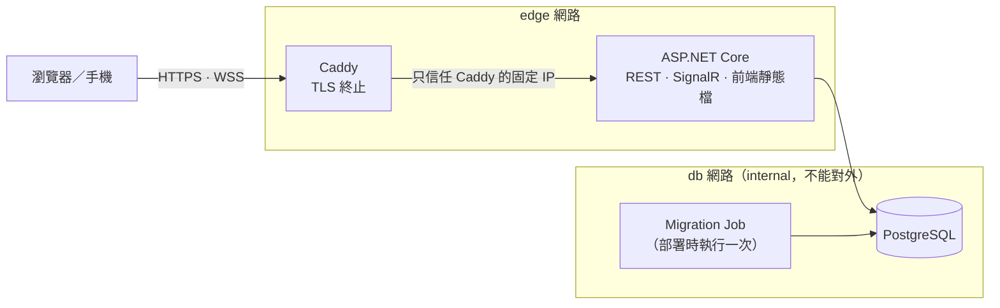
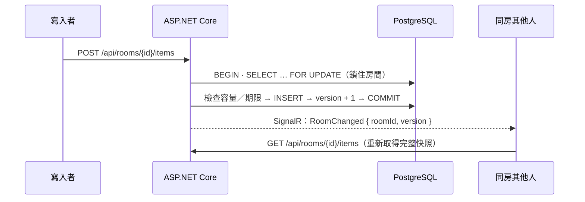

# Pasto

多人即時共享剪貼簿。不用註冊就能建立房間，其他人用六碼房碼、分享連結或 QR Code 加入，就能在會議室電腦、遠端電腦、跳板機與手機之間交換文字。

> 這是一個學習 System Design、Concurrency 與 AI-assisted Development 的個人專案。重點放在「正確性有證據」：交易邊界、併發、授權與部署都由真實 PostgreSQL 與容器環境驗證，不只依賴 mock。

<!-- Demo 網址與截圖：AWS demo 上線後補上。
**Demo：** https://<demo-domain>


-->

## 功能

- 匿名建房，房間建立後固定 5 小時失效，到期或房主關房後自動清除資料
- 六碼房碼、分享連結或 QR Code 加入
- 多筆純文字：新增、一鍵複製、刪除自己的文字（每筆 8 KiB、每房 300 筆）
- SignalR 即時同步。斷線、重連或切回前景時自動向伺服器重新同步
- 淺色／深色主題，手機與桌面版面

不含檔案上傳、文字編輯、帳號系統與公開房間列表。完整範圍見 [需求規格](docs/requirements.md)。

## 架構

Modular Monolith：單一 ASP.NET Core 程序，內部分為 API、Application、Domain、Infrastructure 四層。PostgreSQL 是唯一的 Source of Truth。REST 負責所有資料操作，SignalR 只負責通知「有變更」。



一次寫入的流程：



通知只帶房間 ID 和版本號，不帶內容。Client 收到後一律向 REST 重新取得資料，所以通知重複、遺漏或順序錯亂都不會讓畫面錯誤，最多晚一點更新。詳見 [架構設計 §5–§6](docs/architecture.md)。

## 技術重點

### 併發與資料一致性

- 同一房間的新增、刪除、關房都先用 `SELECT … FOR UPDATE` 鎖住房間列，在同一個交易內檢查容量與期限後才寫入。等鎖有逾時上限，逾時會回 503，不會無限期卡住。
- 容量和期限以鎖定後的資料庫時間判斷，所以「等鎖期間房間剛好到期」也會被拒絕。
- 整合測試在真實 PostgreSQL 上製造鎖競爭，驗證同時新增到滿房、同時刪除同一筆、關房與新增交錯等情境。 [交易與鎖設計](docs/s1-04-item-transactions.md) · [期限邊界](docs/s1-05-expiry-boundaries.md)

### 即時同步不依賴 SignalR 的送達保證

- 交易提交後才發通知，所以 Client 永遠不會收到「之後被回滾」的變更。
- SignalR 斷線或 Hub 暫時無法使用時，前端改用 REST 補讀，寫入也不受同步狀態影響。 [S5 審查紀錄](docs/s5-review.md)

### 匿名身分與授權

- 每位參與者拿到一組 128-bit 隨機憑證，資料庫只存 SHA-256 雜湊。
- 分享連結與 QR Code 只含房碼。憑證不會出現在分享內容、應用程式日誌或代理日誌中。
- REST 與 SignalR 使用同一套驗證，每個請求都檢查「這位參與者是否屬於這個房間」。 [匿名身分 API](docs/s2-api-identity.md)

### 分層的濫用防護

- Token bucket 限流分三個層級：每來源 IP、全站、每位參與者，分別限制建房、加入、讀取和寫入。
- 同一來源連續輸錯房碼會被暫停加入，而且重犯時暫停得更久。全站短時間內累積大量錯誤房碼時進入壓力模式，只收緊「加入房間」，已在房內的讀寫不受影響。
- SignalR 有全站與每來源的連線配額，HTTP 有並行處理上限與過載判斷，超限時回 429／503 並附 `Retry-After`。 [分層防護設計](docs/architecture.md)

### 部署

- Caddy 終止 TLS，App 和 PostgreSQL 不對外發布連接埠。兩層 Docker 網路隔離，App 只採信 Caddy 固定 IP 轉來的 `X-Forwarded-*`。
- Migration 由獨立的 Job 執行，App 使用權限較小的帳號：可以讀寫資料，但不能建表或修改遷移歷史。App 啟動時會核對 schema 版本，不相容就拒絕啟動。
- 曾發現 Docker Desktop 的連接埠轉送會讓所有用戶端看起來來自同一個 IP，因此每來源限流改在 Linux Docker Engine 上驗收。 [自架部署指南](deploy/README.md)

### 可觀測性

Serilog 結構化日誌、存活與就緒健康檢查，以及選配的 OpenTelemetry OTLP 匯出。日誌和 trace 會遮蔽房碼、憑證與文字內容。

## 測試策略

| 層級 | 方式 |
| --- | --- |
| 後端整合測試 | xUnit 跑在真實 PostgreSQL 18，每個測試使用獨立 schema，可以平行執行。涵蓋交易、鎖競爭、期限邊界、授權、限流與 Migration 結構 |
| 前端 | Playwright 以 Microsoft Edge 驗證互動、錯誤狀態、重連與過載重試 |
| 部署驗收 | 在 Docker Desktop 與 Linux Docker Engine 實際驗證網路隔離、代理信任、TLS、WSS、日誌遮蔽、重啟恢復，並用手機實機測試剪貼簿 |

測試數量、執行命令與每次的驗證結果記錄在 [測試紀錄](docs/testing.md)。

## AI 協作開發

這個專案由多個 AI Agent 分工完成，人負責需求、架構取捨與最終決策：

- **Implementation Agent（Codex）**：實作功能與測試。
- **Review Agent（Claude Code）**：獨立審查，每個 finding 都要附程式碼位置、失敗情境與證據。
- **共同規則**：Agent 之間的共識不能取代測試證據，Review 結果要經過驗證，Agent 不得自行合併或推送。 [AGENTS.md](AGENTS.md) · [CLAUDE.md](CLAUDE.md)

例如 Deployment 階段的來源 IP 驗收：初測時兩個來源的請求相隔 38 秒，超過限流補充額度所需的時間，所以即使兩者共用同一個額度也會通過。審查時發現這個測試分辨不出兩種情況，於是改成在 162 ms 內完成「A 用完額度 → B 成功 → A 仍被拒」的重測。 [驗收紀錄](docs/testing.md)

## 已知限制

- **容量尚未壓測**：目標是 1,000 條同時連線，S8 會實測，目前沒有宣稱已達標。
- 持有分享連結的人可以反覆加入，把單一房間的 1,000 個參與者名額用完。
- 大量 IPv6 /64 輪流送錯誤房碼，可能讓全站長期處於壓力模式，合法使用者加入時需要重試。

完整清單見 [TODO.md](TODO.md#後續必須保留的事項)。

## 快速開始

### 本機開發

需要 .NET SDK 10.0.402、Node.js 24 與 Docker。

```powershell
# 1. 啟動本機 PostgreSQL（先將 .env.example 複製為 .env，並填入測試密碼）
docker compose up -d --wait

# 2. 套用 Migration 並啟動後端（前端的 Vite proxy 預期後端在 5080）
$env:ConnectionStrings__Pasto = 'Host=127.0.0.1;Port=55432;Database=pasto_test;Username=pasto_test;Password=<本機測試密碼>'
dotnet tool restore
dotnet ef database update --project src/Pasto.Server
dotnet run --project src/Pasto.Server --urls http://127.0.0.1:5080

# 3. 另開終端機啟動前端，開啟 http://localhost:5173
cd src/Pasto.Client
npm ci
npm run dev
```

### 自架部署

Docker Compose 一次啟動 Caddy、App、Migration Job 與 PostgreSQL。正式自架請使用 Linux Docker Engine，Docker Desktop 只適合試用。見 [自架部署指南](deploy/README.md)。

### 執行測試

```powershell
# 後端整合測試（需要步驟 1 的 PostgreSQL）
$env:PASTO_TEST_CONNECTION_STRING = 'Host=127.0.0.1;Port=55432;Database=pasto_test;Username=pasto_test;Password=<本機測試密碼>'
dotnet restore Pasto.slnx --locked-mode
dotnet test Pasto.slnx --configuration Release --no-restore

# 前端檢查與瀏覽器測試
cd src/Pasto.Client
npm run lint
npm run build
npm run test:ui
```

整合測試只接受 loopback 主機，且資料庫名稱必須以 `_test` 結尾，避免誤連正式資料庫。詳見 [測試紀錄](docs/testing.md)。

## Tech Stack

- **Frontend**：React、TypeScript、Vite、Playwright
- **Backend**：ASP.NET Core（.NET 10）、SignalR、EF Core
- **Database**：PostgreSQL 18
- **Observability**：Serilog、OpenTelemetry
- **Infrastructure**：Docker Compose、Caddy

## 專案結構

```text
Pasto/
├─ src/
│  ├─ Pasto.Server/             ASP.NET Core：Api／Application／Domain／Infrastructure
│  └─ Pasto.Client/             React 前端，e2e/ 為 Playwright 測試
├─ tests/
│  └─ Pasto.IntegrationTests/   真實 PostgreSQL 整合測試
├─ deploy/                      自架部署：Compose、Caddyfile、Dockerfile、DB 初始化
├─ docs/                        需求、架構、ADR、各階段設計與測試紀錄
├─ compose.yaml                 本機開發與整合測試用的 PostgreSQL
├─ AGENTS.md / CLAUDE.md        AI Agent 協作規範
└─ TODO.md                      目前進度與下一步
```

## 開發進度

S1～S7、可觀測性與 Deployment 已合併。下一階段是 S8 壓測與文件收尾。

| 階段 | 交付內容 | PR |
| --- | --- | --- |
| S1 持久層與交易核心 | 正式 Migration、建房與 Owner／cascade、併發交易核心、期限邊界 | [#1](https://github.com/ARueiz/Pasto/pull/1)～[#4](https://github.com/ARueiz/Pasto/pull/4) |
| S2 房間與匿名身分 API | 建房、加入、Bearer 憑證、身分恢復、房間資訊、關房 | [#5](https://github.com/ARueiz/Pasto/pull/5) |
| S3 文字操作 | 新增、刪除、整份快照與寫入配額 | [#6](https://github.com/ARueiz/Pasto/pull/6) |
| S4 前端 | 入口頁、房間頁、身分恢復、分享、搜尋與主題切換 | [#7](https://github.com/ARueiz/Pasto/pull/7) |
| S5 即時同步 | SignalR 訂閱、提交後通知、斷線重連與 REST 備援 | [#8](https://github.com/ARueiz/Pasto/pull/8) |
| S6 清理 | 到期與關房資料清理、房碼冷卻回收、連線清理 | [#9](https://github.com/ARueiz/Pasto/pull/9) |
| 可觀測性 | 結構化日誌、健康檢查、OpenTelemetry | [#10](https://github.com/ARueiz/Pasto/pull/10) |
| S7 安全與濫用防護 | 憑證查詢防護、公開加入防護、SignalR 配額、HTTP 過載保護 | [#11](https://github.com/ARueiz/Pasto/pull/11) |
| Deployment | 同源前端、Caddy TLS、雙層網路、Migration Job、自架 Compose | [#13](https://github.com/ARueiz/Pasto/pull/13) |
| S8 壓測與收尾 | 1,000 連線、同 NAT、熱房、大量重連與清理的負載驗證 | 進行中 |

各階段的測試數量與驗證結果見 [測試紀錄](docs/testing.md)，目前進度與下一步見 [TODO.md](TODO.md)。

## 文件

### 目前進度與操作

- [開發進度與下一步](TODO.md)
- [自架部署與驗收指南](deploy/README.md)
- [整合測試與驗收紀錄](docs/testing.md)
- [Sprint 1 實作計畫](docs/sprint-1-implementation-plan.md)（含 [S8 壓測計畫](docs/sprint-1-implementation-plan.md#13-s8負載證據驗收與文件收尾)）

### 需求與架構決策

- [需求規格](docs/requirements.md)
- [架構設計](docs/architecture.md)
- [ADR 0002：六碼房碼與匿名參與者](docs/decisions/0002-room-code-and-anonymous-participants.md)
- [ADR 0003：MVP 範圍收斂](docs/decisions/0003-mvp-scope-reduction.md)
- [ADR 0004：可觀測性與自架部署](docs/decisions/0004-observability-and-deployment.md)
- [ADR 0001：初始架構提案](docs/decisions/0001-initial-architecture.md)（已撤回，由 ADR 0002 接續）

### 各階段設計與實作紀錄

- [S1-01 入門導讀](docs/s1-01-dotnet-postgresql-guide.md)
- [S1-02 完成報告與維護導讀](docs/s1-02-maintenance-report.md)
- [S1-03 建房流程與驗證](docs/s1-03-room-creation.md)
- [S1-04 交易拆分與 Patch 1 驗證](docs/s1-04-item-transactions.md)
- [S1-05 期限邊界與 S1 驗證對照](docs/s1-05-expiry-boundaries.md)
- [S2 API／匿名身分工作項與 S2-01 設定](docs/s2-api-identity.md)
- [S3 文字 API 與整份快照](docs/s3-items.md)
- [S4 前端 API 串接](docs/s4-api.md)
- [S4 UI 規格](docs/ui-spec.md)
- [S5 審查交接與結果](docs/s5-review.md)
