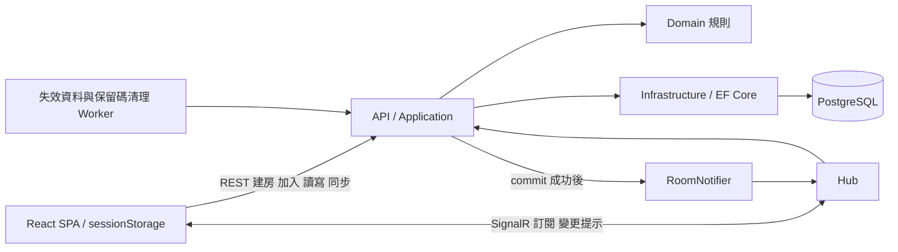

# Pasto Sprint 1 — 最終架構與實作前修訂

更新：2026-10-20；2026-11-05 依 [ADR 0003](decisions/0003-mvp-scope-reduction.md) 收斂 MVP（正式持久層優先、整份快照、基本限流）。Q1～Q7、T1～T8 方向已確認；限流／效能設定須實測，產品程式尚未實作。

規則以 [requirements.md](requirements.md) 為準；現行決策見 [ADR 0002](decisions/0002-room-code-and-anonymous-participants.md) 與 [ADR 0003](decisions/0003-mvp-scope-reduction.md)，[ADR 0001](decisions/0001-initial-architecture.md) 只保留歷史。執行順序見 [Sprint 1 實作計畫](sprint-1-implementation-plan.md)。

## 1. 系統邊界與分層

一個 Rooms 模組、一個 ASP.NET Core Application、一個 PostgreSQL。React SPA 正式環境優先同源；Docker Compose 用於本機／整合環境，不自動提供 HA。PostgreSQL 是 Source of Truth；REST 讀寫，DB commit 後才透過 SignalR 通知。

| 層 | 職責與依賴 |
| --- | --- |
| API | REST／Hub、DTO、憑證解析、限流、ProblemDetails；呼叫 Application，不直接操作 DbContext |
| Application | CreateRoom、JoinRoom、GetParticipant、GetRoomState、ListItems、AddItem、DeleteOwnItem、CloseRoom、SubscribeRoom、PurgeRooms；協調交易與提交後通知，宣告必要窄介面 |
| Domain | 所有權、房主權限、5 小時有效性、8 KiB／300 筆規則；不依賴 HTTP、EF Core、SignalR 或其他層 |
| Infrastructure | EF Core／PostgreSQL、CSPRNG、Credential hash、時間、通知 adapter；實作 Application 介面，依賴 Domain，不依賴 API |

host 可引用 Infrastructure 組裝 DI。先清楚劃分命名空間／資料夾，不為分層建立大量空專案，不加通用 Repository、分頁或 CQRS 框架。

專案結構（ADR 0003）：單一 `src/Pasto.Server`（ASP.NET Core host），以 `Api/`、`Application/`、`Domain/`、`Infrastructure/` 資料夾區分；`tests/Pasto.IntegrationTests` 引用它並對 Migration 建出的 schema 測試正式 use case；root 放 `.slnx` 與本機 PostgreSQL 的 `compose.yaml`。依賴方向暫以慣例與 Code Review 維持，出現跨層引用問題再把 Domain 拆成獨立專案。單實例起步，不導入 Redis、Message Queue、Distributed Lock、Kubernetes 或每次寫入競爭的全站 DB 配額列。

## 2. 識別、授權與身分保存

| 資訊 | 規則與用途 |
| --- | --- |
| Room.Id | 後端 UUID、DB PK、內部關聯、API scope、SignalR group；不是手輸房碼或憑證 |
| Room.Code | CSPRNG 均勻產生固定六碼 A–Z／0–9，DB 正規化明文＋UNIQUE／CHECK。輸入可 trim／轉大寫後驗格式；URL `/r/{code}`，QR 僅此加入 URL |
| Participant.Credential | 後端至少 128-bit CSPRNG，建議 16 bytes Base64URL 無 padding，DB 只存 SHA-256 hash；驗證同房匿名身分，不能放 URL／QR |

Code 有約 31 bits 搜尋空間，猜中即可 Join 並讀內容；Credential 保護身分與操作權，不能補回房碼保密強度。無公開房間列表、不另開未認證房碼存在查詢；所有公開查詢／加入共用分層防護。提醒勿傳密碼、API Key、Token 或其他機密。

REST／Hub 以 Participant Credential 找到 ParticipantId／RoomId，逐次比對路徑／參數與有效房間；Owner／Creator 從後端決定，不信任 body。房主與其他人都只能刪自己的文字，房主可關整房。

sessionStorage 以 Room.Id 存每房 Credential，另存 Code→Room.Id 的分頁內對應。F5 先呼叫 /me 恢復，不重新 Join。失效時停連線、清該房狀態，不拿同 Code 靜默加入可能重配的新 UUID。主動離開只清本分頁，不撤銷其他副本。遺失 Credential 無法恢復舊文字刪除權／房主權。

不使用 localStorage，不依賴 beforeunload 刪 Participant。分頁複製、opener、Session Restore、XSS 可能複製／讀取 sessionStorage，不能保證關頁即銷毀；手機掃碼不繼承原電腦身分。[sessionStorage](https://developer.mozilla.org/en-US/docs/Web/API/Window/sessionStorage)

## 3. 資料模型與資料庫不變條件

| 表 | 主要欄位／約束 |
| --- | --- |
| Rooms | Id UUID PK；Code varchar(6) NOT NULL UNIQUE，CHECK `^[A-Z0-9]{6}$`；CreatorParticipantId UUID NOT NULL；CreatedAt／ExpiresAt timestamptz；DeletedAt nullable；Version bigint；ItemCount int；TotalBytes bigint（統計） |
| RoomParticipants | Id UUID PK；RoomId NOT NULL FK；CredentialHash NOT NULL UNIQUE；CreatedAt；UNIQUE(RoomId, Id) |
| ClipboardItems | Id UUID PK；RoomId NOT NULL FK；OwnerParticipantId NOT NULL；Content text；ContentBytes int；CreatedAt；CreatedVersion bigint |
| RoomCodeReservations | Code varchar(6) PK；ReusableAfter timestamptz NOT NULL；不放文字／Credential，不隨房間 cascade 刪 |

T8 必須保障：Owner／Creator 同房、房間與房主原子建立、RoomId 無孤兒、計數／Version 同交易、關房／清理不破壞關聯。**資料庫需要保障的不變條件已確認，以下 FK／EF 寫入方式是第一階段需驗證的落實方案。**

### 優先驗證的 FK 方案

- RoomParticipants.RoomId → Rooms.Id，ON DELETE CASCADE。
- ClipboardItems.RoomId → Rooms.Id，ON DELETE CASCADE。
- ClipboardItems.(RoomId, OwnerParticipantId) → RoomParticipants.(RoomId, Id)，ON DELETE NO ACTION DEFERRABLE INITIALLY DEFERRED。
- Rooms.(Id, CreatorParticipantId) → RoomParticipants.(RoomId, Id)，同樣 NO ACTION DEFERRABLE INITIALLY DEFERRED。
- Rooms.Code → RoomCodeReservations.Code，NO ACTION，保護仍有房間引用的保留碼。

複合 FK 防止引用其他房間的 Participant。Creator 反向 FK 造成循環：預先產生 UUID，同一交易先插保留碼、Room，再插房主，commit 時檢查；不讓 Creator 長期 nullable，也不產生半完成房。清理 Room 時兩條 cascade 刪 children，反向關係 NO ACTION 延後至 commit 檢查。MVP 不提供單獨刪 Participant。

PostgreSQL 可延後 FK 檢查，但 EF Core 可能先遇到 tracked graph 的排序問題，不能假設一次 SaveChanges 自動成功。S1-01 已證明分階段 EF 寫入（同一 DbTransaction）可行；正式 CreateRoom 沿用此路徑，以整合測試驗 commit／rollback／cascade，不為循環把所有 CRUD 都改成手寫 SQL。

正式 schema 由 EF Core Migration 建立；DEFERRABLE 複合 FK、CHECK 與部分索引以 `migrationBuilder.Sql()` 明確加入，整合測試檢查實際約束（ADR 0003）。S1-01 的測試用 `schema.sql` 在 Migration 涵蓋相同不變條件後移除。[PostgreSQL constraints](https://www.postgresql.org/docs/current/ddl-constraints.html)、[SET CONSTRAINTS](https://www.postgresql.org/docs/current/sql-set-constraints.html)

簡單 IsCreator＋唯一部分索引只能保證最多一位，無法單獨保證每房提交時必有房主，不直接替代目前模型。若實測顯示循環成本不合理，再提出可維持全部不變條件的替代模型與反例測試，先修訂設計，不降級成僅靠 UI／應用慣例。

### 索引與容量規則

| 索引／約束 | 用途 |
| --- | --- |
| Rooms(Code) UNIQUE；RoomParticipants(CredentialHash) UNIQUE | 加入與 Credential 查找／碰撞保護 |
| Rooms(ExpiresAt, Id) WHERE DeletedAt IS NULL | 到期掃描 |
| Rooms(DeletedAt, Id) WHERE DeletedAt IS NOT NULL | 提前關房掃描 |
| RoomParticipants(RoomId, Id) UNIQUE | 同房 FK、Participant 預算與 cascade 查找 |
| ClipboardItems(RoomId, CreatedVersion DESC, Id DESC) | 整份快照的穩定排序與房間資料查找；日後恢復 Keyset 分頁時沿用 |
| ClipboardItems(RoomId, OwnerParticipantId) | Owner FK referencing-side 查找；FK 不自動建此索引 |
| RoomCodeReservations(ReusableAfter, Code) | 保留碼回收 |
| CHECK／NOT NULL | 計數／Version 非負、ContentBytes 為 1～8,192 且符合 UTF-8 octet_length(Content)、有效時間關係 |

後端另外拒絕全空白。每房筆數跨列規則由鎖內交易保障；TotalBytes 可同交易增減，僅供統計／觀測，不以每房總 bytes 拒絕新增，也不設 1.5 MiB CHECK。原文 8 KiB 與 JSON Body 32 KiB 分別檢查，不截斷。

Version 對實際新增、實際刪除及關房加一；加入／身分恢復不增加內容版本，重刪不存在項目不增加。API bigint 版本用十進位字串，Client 用 BigInt 比較，不用 Number 或字典序。Content 不建全文索引；後續依查詢計畫調整。

## 4. REST 契約與錯誤

受保護 API 帶 `Authorization: Bearer <participantCredential>`，使用不透明憑證驗證器，並非 JWT。每次限定 Participant.RoomId、路徑 Room.Id、item RoomId，檢查未過期且 DeletedAt 為 NULL。公開加入只知道 Code，不能以 Code 直接呼叫文字 API。

| API | 驗證與成功結果 |
| --- | --- |
| POST /api/rooms | 公開建房限流與 admission；201 回 roomId、code、joinUrl、expiresAt、version、participantId、credential、isCreator=true |
| POST /api/rooms/join，body: code | 公開猜碼／失敗／每房 Participant 保護；201 回新 Participant Credential 及房間資訊，isCreator=false |
| GET /api/rooms/{roomId}/me | Bearer＋同房有效性；回自己的 Participant 與房主狀態，不建立新身分 |
| GET /api/rooms/{roomId} | Bearer＋同房有效性；回 version、itemCount、totalBytes（統計）、expiresAt、serverTime、限制；不含文字 |
| GET /api/rooms/{roomId}/items | Bearer＋同房有效性；一次回全部有效 items、snapshotVersion、itemCount、expiresAt（MVP 無 limit／cursor，ADR 0003）；每筆可回 isOwn／canDelete 供 UI，但後端仍授權 |
| POST /api/rooms/{roomId}/items，body: content | Bearer；鎖內驗證 8 KiB／300 筆；Owner 取自驗證器；201 回 item 與 committedVersion，作同步提示，不直接拼入快照 |
| DELETE /api/rooms/{roomId}/items/{itemId} | Bearer＋Owner；200 回 changed、committedVersion；同房不存在 changed=false、不扣計數／加版本；非本人 403，房主亦同 |
| DELETE /api/rooms/{roomId} | Bearer＋Creator；設定 DeletedAt／Version，commit 後 204，Client 終止本房；其他人 403，已失效 404 |

方案 A 不需要新增單筆 GET 或 committed change／previousVersion 協定；從第一版契約移除，未來局部同步再另設計。body 不接受 Owner／Creator 等可寫授權欄位。憑證與內容回應皆 no-store。

| HTTP／code | 意義與 Client 行為 |
| --- | --- |
| 400 EmptyContent／TextTooLarge／InvalidRequest | 原文空白、超 8 KiB 或格式錯；保留使用者輸入並提示修正 |
| 413 RequestBodyTooLarge | JSON Body 超 32 KiB；獨立於原文限制 |
| 401 ParticipantUnauthorized | 缺少／無效／不屬該房 Credential；停操作與連線，不自動建新身分 |
| 403 ItemDeleteForbidden／RoomDeleteForbidden | 身分有效但無操作權；不變更畫面成假成功 |
| 404 RoomUnavailable | 不存在／過期／關房對外相同；清該 UUID 的本機狀態，不能靜默換房 |
| 409 RoomItemLimitReached／ParticipantLimitReached | 300 筆或候選 Participant 預算已滿；不得把 TotalBytes 當容量錯誤 |
| 429 RateLimited | Retry-After；合併同步工作並退避，不每個通知各排重試 |
| 503 Overloaded／ServiceUnavailable | 高負載或 DB 暫時失敗，明確顯示；結果不確定的 POST 不自動重送 |

ProblemDetails 含 code／correlationId，不含內容、Credential 或 stack trace。POST 提交後回應遺失可能已成功：提示不確定並重新讀取狀態；建房／加入憑證回應遺失無法找回，不自動重送，不做內容去重。通知失敗不把已提交操作回成假回滾。成功回傳 committedVersion 只表示 DB 提交，不表示全部 Client 已同步。

## 5. 交易、鎖與期限

建房在一個 transaction 寫保留碼、Rooms（ExpiresAt = CreatedAt + 5 小時）與房主；UNIQUE 衝突回滾再重產碼，有界重試候選 5 次、耗盡回 503，不先 SELECT 空碼就當作取得。重試上限可設定／監控，不揭露其他房間。

Join 依 Code 找到並鎖 Rooms，再檢查 DB 當下時間、DeletedAt、每房 Participant 預算，插新身分。F5 走 /me，不建立新 Participant。

新增／刪除／關房統一流程：驗證身分與格式 → 開短 transaction → SELECT Rooms FOR UPDATE → 鎖後重查期限／DeletedAt／權限 → 改 items、ItemCount、TotalBytes 統計與 Version → commit → SignalR 通知。新增不檢查每房總 bytes。關房只快速記 DeletedAt，再交 Worker 實體刪。

鎖順序 Rooms → children，Join／關房／清理一致。同房序列化，異房不互鎖；設有界等待及監控，不在持鎖時等網路推播。DB Row Lock 不是程序內 lock 或 Distributed Lock。[PostgreSQL row locks](https://www.postgresql.org/docs/current/explicit-locking.html)

到期以取得鎖後 DB 當下時間（例如 clock_timestamp）判定，不用交易起始時間；等待鎖後已到期要拒絕。讀取以授權快照檢查點判定。到期／關房前已被接受的短交易或在途回應可能稍晚完成，不能承諾遠端撤回已取得資料。邊界由第一階段測試固定其語意。[PostgreSQL time functions](https://www.postgresql.org/docs/current/functions-datetime.html)

## 6. 方案 A：合併通知後重新取得權威資料

### Hub 與最小 Client 狀態

Hub 使用同一 Participant 驗證器，SubscribeRoom(roomId) 驗證同房／有效性，每連線一房；不能由 Client 任選 groupName。Server 使用內部 Room.Id 當 group。連線後 AddToGroup 完再重查有效性，避免驗證後才關房的競爭；失效則移除並拒絕訂閱確認。

通知統一為 `RoomChanged { roomId, version }`，只代表已提交的房間狀態變動，沒有正文、itemId、previousVersion 或可回放的事件序號。關房也可發此提示，Client 接著 REST 得到 RoomUnavailable。重複／亂序只需保留最高 observedVersion 與一個 dirty 標記，不逐筆套用、不等版本連續、不保存事件佇列。

Client 只需少量狀態：目前 Room.Id／generation、已顯示 snapshotVersion、最高 observedVersion、dirty、單一進行中工作、同步 UI 狀態。沒有事件缺號緩衝或完整局部新增／刪除狀態機。

### 訂閱、通知合併與舊回應保護

1. 註冊 handler → 建立 SignalR → SubscribeRoom 成功 → REST 取整份快照。載入期間新提示更新 observedVersion／dirty，不排事件清單。
2. 收到同房 version 大於本機時，合併通知安排同步。候選 debounce 150 ms、最長等待 500 ms，重複提示不各發 GET；已有進行中的工作只設 dirty，不開第二個同步流程。
3. 提示只作是否需同步的依據。不能直接把通知的 version 當已套用版本，也不能只因最大提示版本已讀過就忽略到期／授權狀態檢查。
4. 每個同步 round 以一次 GET 取得整份快照，成功後整體替換。滿房時每次都重抓全部，此取捨會增加讀取，靠合併與壓測觀察，之後才評估分頁或局部更新（ADR 0003）。
5. 切房、離開、身分／房間失效時增加 generation、AbortController 取消舊 round；同房新 round 亦有 request 序號。所有成功與錯誤回應先比對 Room.Id／generation／適用的 request 序號，過期的 401／404 亦不得清掉新房身分。快照另外要求候選 snapshotVersion 不低於已顯示版本才可提交。Abort 不是唯一保護，已完成／無法及時取消的回應仍須比對；metadata 與 /me 檢查同樣綁定發出時的身分／房間。
6. round 期間若收到更新提示：可提交不倒退的快照但維持「同步中」，完成後再合併跑一次；若候選版本已涵蓋最高 observedVersion，且沒有較新檢查／失效狀態，才標為同步完成。有限重試失敗保留明確過期標記，不能假稱最新。
7. POST／DELETE 成功只安排一次重新同步（committedVersion 可作提示），不直接把回應 item 拼入既有快照。POST 不確定不重送；關房成功立即終止本房狀態。

### 整份快照（MVP，ADR 0003）

每房最多 300 筆 × 8 KiB，MVP 不分頁，避免簽章游標、跨頁版本衝突與部分載入狀態。

- 一次請求在短唯讀 REPEATABLE READ 交易內讀有效房間、Version、ItemCount 與全部 items，三者來自同一快照。排序 CreatedVersion DESC、Id DESC，DB 查詢限定 RoomId，使用 `ix_items_order`。
- 回應不截斷單筆；滿房原文約 2.4 MB，加上 JSON 跳脫與欄位可能更大，大小與傳輸成本由壓測量測。
- Client 以 snapshotVersion 不低於已顯示版本為提交條件，整體替換 items、版本與計數；較新 metadata 只提示待同步。
- 沒有「載入更多」與「已載入 N／itemCount」狀態；載入中與同步中之外，畫面上的列表就是該版本的完整內容。

持續高頻寫入的熱房會讓每次提示都重抓整份快照，這是 MVP 的已知限制；以通知合併、單一進行中 round 與限流處理。若壓測顯示頻寬、DB 讀取或 p95 不符目標，再以新 ADR 恢復版本綁定的 Keyset 分頁（游標綁 RoomId＋snapshotVersion 並簽章、跨頁版本不同回 409 SnapshotChanged）或評估局部更新；現有排序索引可直接沿用。

### 遺漏、重連、前景與失效

前景每次隨機間隔 15～20 秒 GET 房間 metadata；版本相同不取正文，不同則合併安排 round。1,000 個前景頁光探測約 50～67 次／秒，另有快照、寫入、重連，皆納入壓測。回前景／網路恢復立即檢查。主要修復目標 20～30 秒、最長約 60 秒可接受；timer 不等於完成延遲保證。

明確啟用自動重連，initial start 失敗另處理；指數退避＋jitter／最大間隔。每次重連用原 Credential 驗證、SubscribeRoom、重新讀所需範圍；不能假設 group 或事件會自動恢復。[SignalR groups](https://learn.microsoft.com/en-us/aspnet/core/signalr/groups?view=aspnetcore-10.0)

401／RoomUnavailable 是該身分／UUID 的終止狀態：增加 generation、清文字／該房 Credential、停工作與連線，不自動 Join 同 Code。到期倒數可用 expiresAt／serverTime 校準，但 DB 判定才是權威。同步中／斷線停用寫入，已顯示文字仍可複製；背景節流／離線不保證修復時限。

host 維持有界 connectionId／RoomId／Participant／到期追蹤。關房 commit 後盡力提示並清 group／中止連線，到期亦清線；group 並非授權。清線通知可能延遲，所有 REST 與 Hub invocation 仍重驗，沒有正文推播。DB commit 後程序中斷仍可能漏通知，靠上述 REST 校正；無持久回放、Outbox、Message Queue 或 exactly-once。

## 7. 冷卻、失效與清理

採獨立 PostgreSQL RoomCodeReservations，Code PK＋Rooms.Code UNIQUE 保證保留／使用唯一性；與建房同 transaction 取得碼。ReusableAfter 至少為原 ExpiresAt + 24 小時，提前關房不縮短。Room 主資料可以先刪，保留碼不 cascade。

Worker 只有 now ≥ ReusableAfter 且無 Rooms 引用才刪保留碼；FK 防止清掉有效引用，唯一插入仲裁回收／重用競爭。不只查 Rooms 空缺就當可用。冷卻後可重配，不保證永久唯一；舊 URL／QR 仍可能指到新房，但舊 Credential 綁原 UUID、不會變成新房身分。

邏輯失效：DeletedAt 非 NULL 或 ExpiresAt ≤ DB 當下時間就拒絕新操作，不依賴 Worker。DeletedAt 不是可查歷史／可還原資料。

實體清理：每分鐘執行一次，以失效時間最早者優先，合併到期與提前關房的索引候選，避免其中一類飢餓；每批最多 100 房，SELECT FOR UPDATE SKIP LOCKED、鎖內重查後刪 Room 並 cascade children。每輪可多批，但候選時間預算 20 秒、超過留待下輪，不與自己重疊、不長持鎖等網路。

健康運作下以失效後 10 分鐘內完成 Rooms／Participants／items 清理為目標，量測每批交易成本、數量、backlog、最久失效時間及跳鎖情況。重跑安全、停機恢復補清。保留碼回收另有有界批次，不因失效主資料清理延後而提早釋碼。

無產品層備份／還原；DELETE 不等於安全抹除，WAL、基礎設施快照、日誌及 Client 副本各有生命週期，部署前確認實況，不承諾全副本即時消失。

## 8. 分層防護與資源保護

**MVP 範圍（ADR 0003）**：只實作 ASP.NET Core 內建 Rate Limiter 的公開建房／加入（每 IP＋全站 token bucket）、已驗證新增／刪除限制、每房 Participant 上限、DB pool 上限、可信代理與日誌脫敏；Hub 方法仍驗證身分與房間。本節其餘機制（錯碼退避、全站壓力模式、partition 上限、HTTP 分類並行、SignalR 細部配額、資源 admission）於 S7 依實測補齊，補齊前不發布公開站台。

所有候選數字集中在需求第 5 節，標示「待安全測試與壓測調整」。公開建房／加入較嚴格，無效嘗試計數與退避、全站壓力模式共同防護，不只用單一 IP，也不因拿到某個房碼就繞過限流。全站壓力模式會影響合法加入，需監控／恢復遲滯，不能宣稱完全防止分散式猜碼。

已驗證 Participant／RoomId 的配額較寬鬆，IP 只粗保護，不作所有權。1,000 人同 NAT 的既有連線測試不能被小額 IP 連線上限阻擋；千人全新公開加入的速率則應另測並分批暖機，不偷偷繞過限流。典型 5 人不是房間硬上限。

避免任意 Code／無效 Credential 建立 partition；僅固定全站鍵、可信 IP 或已驗證內部 ID，鍵數／TTL 有界，耗盡時新鍵套保守共用桶，不直接放行。只信任已配置 Reverse Proxy allowlist 的 forwarded headers，不讓 Client 自填 X-Forwarded-For。[ASP.NET Core rate limiting](https://learn.microsoft.com/en-us/aspnet/core/performance/rate-limit?view=aspnetcore-10.0)

HTTP limiter 不涵蓋每次 Hub invocation，SubscribeRoom 仍驗證／限頻；SignalR 長連線／long polling 由獨立連線預算保護，不能將常駐 transport 算入短 HTTP 工作的 96 額度而把所有 REST 堵住。偽造 Credential 不使用已驗證協商寬鬆額度。

每房 Participant 生命週期候選上限 1,000 筆，在 Room 鎖內檢查；不用 beforeunload 清列，不刪還被 Owner／Creator 引用的 Participant，原憑證恢復不算新名額。此為資料預算，不是在線人數。

全域優先 HTTP 分類並行、DB pool、SignalR 連線及部署 CPU／記憶體／磁碟限制。API pool Max 64 與 Worker Max 4 是候選，合計 68 加維運餘裕納入 DB max_connections；不是每個 use case 各建 64 條 pool。Npgsql pool／timeout 行為需依實際版本驗證。[Npgsql parameters](https://www.npgsql.org/doc/connection-string-parameters.html)

高負載優先降新建房／加入 admission，必要時降新增文字，保留已存在房間讀取、刪除及 Worker。監控 pool 等待、lock timeout、CPU／記憶體及磁碟；未滿碟前保留清理空間。這些不是精確資料總量配額，不引入每次寫入都搶的全站 DB 計數器。單實例 limiter 不代表未來多實例全域一致；擴展時另評估。

## 9. 隱私與安全

- HTTPS/WSS、同源優先；開發 CORS 精確 allowlist，WebSocket Origin 另驗，不能用 CORS 代替授權。
- 分享 URL／QR 只帶 Code；QR 在 Client 對加入 URL 產生，不使用第三方遠端 QR 服務，不於本次選套件或實作。
- Credential／Content 不記一般 log、例外或 analytics；房碼也預設遮蔽，指標避免高基數。SignalR Browser transport 的 access_token query 特例只在精確 Hub 路徑讀取，代理／APM／trace 全鏈路脫敏。[SignalR security](https://learn.microsoft.com/en-us/aspnet/core/signalr/security?view=aspnetcore-10.0)
- Referrer-Policy: no-referrer、Cache-Control: no-store、CSP；React 文字節點／textarea，不用 dangerouslySetInnerHTML、不自動預覽／執行 URL；文字不存 localStorage 或 Service Worker cache。
- sessionStorage 可被同源腳本讀取，不等同 HttpOnly；不自動附帶登入 cookie。若未來改 cookie，重評 CSRF。連線字串與簽章金鑰用部署 secret，不進 repo。
- 匿名不是無網路識別，伺服器可讀文字、不承諾端對端加密；截圖、剪貼簿、已下載內容與憑證副本無法遠端收回。

## 10. Phase 2：檔案擴充方向（不實作）

未來小型圖片、PDF、Excel 等檔案優先考慮 Object Storage 存實際內容，PostgreSQL 存 Metadata；沿用 Room／Participant／Owner 授權，檔案配額與文字 8 KiB／300 筆分開，不能挪用 TotalBytes 文字統計作混合配額。

檔案上傳／下載各自驗證有效房間、身分與所有權相關操作；另訂大小、型別／內容驗證、惡意檔案處理、下載標頭與私有存取策略，不能因猜中物件 key 直接公開下載。具期限的存取 URL 如採用，需考慮關房後仍存活的窗口。

房間到期／關閉立即邏輯拒絕新檔案操作；DB transaction 不能原子刪 Object Storage，未來需可重試、冪等的實體清理及孤兒物件補償，觀測重試／backlog。屆時再決定機制，不提前導入 Queue／Outbox。

本次不建立 RoomFiles、IFileStorage、檔案 API、Object Storage 服務或相關套件，只記錄演進方向。

## 11. 驗證與演進條件

第一階段以真 PostgreSQL 對正式 Migration 與正式 use case 驗證 Creator／Owner 複合 FK、EF 排序、deferred commit、cascade、同房併發及期限，不用 EF InMemory／SQLite 取代。列表驗證同交易快照、排序與滿房完整回傳；Client 驗證 dirty／generation／單一 round，無需事件重放測試框架。

之後依需求 AC-01～AC-15 測安全與 1,000 連線、熱房、同 NAT、300 筆×8 KiB、重連風暴／補償流量，量測方案 A 整份快照的查詢／傳輸放大及熱房收斂。硬體、候選 p95、每秒 20 次平衡新增／刪除仍待實測。達瓶頸先調查詢、限制、通知合併及單實例資源；需要時才另評估局部同步、多實例 SignalR backplane／託管服務，不重採 ADR 0001 的共同權限模型。

目前只有 S1-01 整合測試骨架；尚未建立產品專案、正式 Migration，也未執行應用程式測試／壓測。
