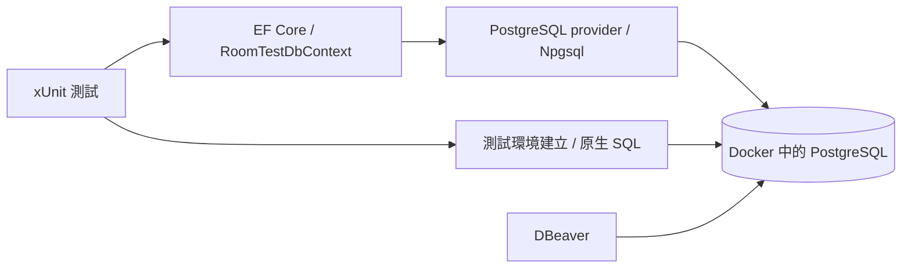

# Pasto S1-01 入門導讀：從建立專案到理解 PostgreSQL、EF Core 與驗證

日期：2026-10-20。對象：剛接觸 .NET／PostgreSQL／EF Core 的開發者。本文件保留 S1-01 當時的程式與建立過程，不要求你先熟悉 ASP.NET Core。

> 2026-11-08：S1-02 已將下文的測試用 `schema.sql`／`RoomTestDbContext` 移除，改成 `src/Pasto.Server` 的正式模型與 Migration，共六個測試。下文的檔案結構與程式片段僅供歷史教學；現行可執行指令與檔案位置以 [testing.md](testing.md) 為準。舊版檔案可由 Git commit `211a2a6` 查閱。

**S1-01 當時完成的是資料庫整合測試專案，只有兩個 Creator 測試；API／前端／SignalR 尚未實作。** 文中的 API 章節是設計導讀，不能直接發 HTTP 請求執行。

快速操作見 [testing.md](testing.md)；正式規則見 [requirements.md](requirements.md)，架構見 [architecture.md](architecture.md)。學習順序建議：先跑第 2 節 → 看第 4、5 節 → 追第 6、7 節程式 → 再讀 API 與後續驗證。

## 1. 先認識工具各自負責什麼

| 名稱 | 在這個專案的角色 |
| --- | --- |
| C# | 撰寫類別、資料庫操作與測試的語言 |
| .NET SDK | 提供 dotnet 指令、編譯器與建立／測試工具；本專案選 10.0.402 |
| .NET Runtime | 執行編譯後的 .NET 程式；SDK 本身也附執行所需 runtime，版本編號不一定與 SDK 相同 |
| ASP.NET Core | 未來執行 HTTP API 與 SignalR 的 Web 框架；目前測試專案沒有 Web Server |
| NuGet | .NET 套件來源與相依管理；用途近似 npm，但套件與工具生態不同 |
| PostgreSQL | 真正保存資料、執行 SQL、交易、外鍵及鎖的資料庫伺服器 |
| Docker | 執行本機 PostgreSQL 容器；不是資料庫本身 |
| DBeaver | 連到 PostgreSQL 看資料／約束與執行 SQL；不負責執行 C# 測試 |
| Npgsql | .NET 連 PostgreSQL 的驅動程式，可直接送 SQL |
| EF Core | 將 C# 類別／查詢與關聯式資料庫對應的 ORM，透過 provider 使用 Npgsql |
| xUnit | 定義測試案例與 Assert；判斷結果是否符合預期 |
| VSTest／Test SDK | 讓 dotnet test 與 IDE 探索及執行 xUnit 案例 |

目前資料流：



你可以把一次測試理解為：「C# 連真 PostgreSQL 建暫存表，寫入資料、提交交易，再讀回資料做比較」。目前沒有瀏覽器或 API 參與。

## 2. 先執行現有專案

以下 PowerShell 指令在 `C:\Projects\Pasto` 執行。你已有程式碼時，從本節開始；不用重新執行下一節的 dotnet new。

### 2.1 確認 SDK 與資料庫

```powershell
Set-Location C:\Projects\Pasto
dotnet --list-sdks
```

確認能使用 10.0.402。root [global.json](../global.json) 指定此 SDK，latestPatch 允許同 feature band 的更新 patch，不是任意升級到另一個 major／feature band。[SDK 選擇規則](https://learn.microsoft.com/en-us/dotnet/core/tools/global-json)

若先前容器仍在執行，不再建立一次。尚未建立時，才使用：

```powershell
docker run --name pasto-postgres-test --rm -e POSTGRES_USER=pasto_test -e POSTGRES_PASSWORD=pasto_test_local -e POSTGRES_DB=pasto_test -p 127.0.0.1:55432:5432 -d postgres:18.6
docker exec pasto-postgres-test pg_isready -U pasto_test -d pasto_test
```

`55432` 是 Windows 這端的 port，`5432` 是容器內 PostgreSQL 的 port；所以 DBeaver 與 Windows 上的測試都連 `127.0.0.1:55432`。映像固定 18.6，避免 latest 悄悄換版本。這組帳密是本機測試示範值；--rm 代表可拋棄環境，停止後會移除容器與其匿名資料 volume。[PostgreSQL 官方映像](https://hub.docker.com/_/postgres)

### 2.2 設定連線

```powershell
$env:PASTO_TEST_CONNECTION_STRING = 'Host=127.0.0.1;Port=55432;Database=pasto_test;Username=pasto_test;Password=pasto_test_local'
```

| 參數 | 用途 |
| --- | --- |
| Host／Port | PostgreSQL 的位置，不是未來 HTTP API 的網址／port |
| Database | 連哪一個 database，這裡是 pasto_test |
| Username／Password | DB 登入角色的帳密；與房間 Participant Credential 完全不同 |
| PASTO_TEST_CONNECTION_STRING | 本專案自訂的環境變數名稱，由 PostgresTestDatabase 讀取 |

此環境變數只設定在目前 PowerShell 與其啟動的子程序；新開終端機要再設定。不把自己的連線密碼提交到 Git。測試程式要求 loopback Host，Database 名稱以 `_test` 結尾，且 DB 角色須能建／刪 schema。

### 2.3 還原、編譯、測試

```powershell
dotnet restore tests/Pasto.IntegrationTests/Pasto.IntegrationTests.csproj --locked-mode
dotnet build tests/Pasto.IntegrationTests/Pasto.IntegrationTests.csproj --configuration Release --no-restore
dotnet test tests/Pasto.IntegrationTests/Pasto.IntegrationTests.csproj --configuration Release --no-build --no-restore --logger 'console;verbosity=normal'
```

| 指令／選項 | 意義 |
| --- | --- |
| restore | 下載／確認 NuGet 相依；不建立 DB 表 |
| --locked-mode | 必須符合既有 packages.lock.json，不任意重新選相依版本 |
| build | 把 .cs 編譯成可執行的組件，輸出到 bin／obj；不代表 DB 邏輯正確 |
| --configuration Release | 使用 Release 設定；沒有此參數一般是 Debug |
| test | 執行測試、建立暫存 schema、連真 DB 驗證結果 |
| --no-restore | 前一步已還原，這一步不再還原 |
| --no-build | 前一步已編譯，這一步直接執行；程式改過就先重新 build |

也可以不拆 build，讓 test 自動編譯：

```powershell
dotnet test tests/Pasto.IntegrationTests/Pasto.IntegrationTests.csproj --configuration Release --no-restore
```

成功時是 2 個通過、0 個失敗，exit code 0。這裡的 2 個案例都通過，包含「資料庫應拒絕錯誤資料」的反例。若真正連線失敗或斷言不符，exit code 會非零，不是 skip。

只跑一個案例／查看詳細輸出：

```powershell
dotnet test tests/Pasto.IntegrationTests/Pasto.IntegrationTests.csproj -c Release --no-restore --filter 'FullyQualifiedName~SameRoomCreator' --logger 'console;verbosity=detailed'
```

格式檢查：

```powershell
dotnet format tests/Pasto.IntegrationTests/Pasto.IntegrationTests.csproj --no-restore --verify-no-changes
```

目前沒有 root solution，執行時指定 .csproj 路徑；dotnet test 不會啟動可讓 Postman／瀏覽器存取的 API。

## 3. 這個專案是如何建立的

### 3.1 實際做法與練習範本

目前 repo 的 .csproj、DDL、mapping 與案例是明確建立的最小檔案；不是靠一個指令自動產生整個 Pasto。若你想學習「從零取得一個 xUnit 空殼」，可在**另一個空白練習目錄**執行下列指令，不要覆蓋現有 repo：

```powershell
dotnet new globaljson --sdk-version 10.0.402 --roll-forward latestPatch
dotnet new xunit --name Pasto.IntegrationTests --output tests/Pasto.IntegrationTests --framework net10.0 --no-restore
```

`--name` 是專案名稱、`--output` 是輸出路徑、`--framework` 指定目標 .NET、`--no-restore` 暫不下載套件。dotnet new 只產生範本，並不知道 Pasto 的四張表、交易與測試。[dotnet new 官方說明](https://learn.microsoft.com/en-us/dotnet/core/tools/dotnet-new)

範本套件隨 SDK 可能不同，請將產生的 .csproj 對照 [現有專案檔](../tests/Pasto.IntegrationTests/Pasto.IntegrationTests.csproj) 調整；範本可能帶額外 coverage 套件，現有版本只有下列四個直接相依。範本的 UnitTest1.cs 是示範空測試，練習時可移除並換成實際案例。

### 3.2 套件指令與 .csproj

在練習專案加入／指定四個版本的指令如下，執行後仍須對照現有 .csproj 的其他設定：

```powershell
dotnet package add Microsoft.NET.Test.Sdk --project tests/Pasto.IntegrationTests/Pasto.IntegrationTests.csproj --version 18.0.1 --no-restore
dotnet package add Npgsql.EntityFrameworkCore.PostgreSQL --project tests/Pasto.IntegrationTests/Pasto.IntegrationTests.csproj --version 10.0.3 --no-restore
dotnet package add xunit --project tests/Pasto.IntegrationTests/Pasto.IntegrationTests.csproj --version 2.9.3 --no-restore
dotnet package add xunit.runner.visualstudio --project tests/Pasto.IntegrationTests/Pasto.IntegrationTests.csproj --version 3.1.5 --no-restore
```

這是 .NET 10 的名詞在前語法；舊式 dotnet add ... package 也常見。其工作是修改 PackageReference，`--no-restore` 讓下載留到之後。[dotnet package add 官方說明](https://learn.microsoft.com/en-us/dotnet/core/tools/dotnet-package-add)

接著還要自己撰寫／參考並複製目前的 CreatorIntegrityTests.cs、PostgresTestDatabase.cs、Persistence 下的 RoomTestDbContext.cs 與 schema.sql；**套件指令不會產生這些商業模型或案例**。

專案檔重要設定：

| 設定 | 意義 |
| --- | --- |
| TargetFramework=net10.0 | 編譯／執行的目標平台 |
| ImplicitUsings=enable | SDK 自動帶入常用 using，減少重複程式碼 |
| Nullable=enable | 檢查可能為 null 的參考型別；仍需 DB NOT NULL 等執行期保護 |
| IsTestProject=true／IsPackable=false | 標為測試專案，沒有要發布成一般套件 |
| RestorePackagesWithLockFile=true | restore 產生 packages.lock.json，記錄實際直接／間接相依 |
| TreatWarningsAsErrors=true | 編譯警告當成錯誤，避免忽略可疑問題 |
| PrivateAssets=all（runner） | runner 是本專案工具，不向使用這個專案的其他專案傳遞套件資產 |
| schema.sql CopyToOutputDirectory=PreserveNewest | 將 SQL 複製到輸出目錄，測試才能從 AppContext.BaseDirectory 找到它 |

provider 間接帶入 EF Core／Npgsql，因此沒有再重複新增直接相依；實際解析版本見 packages.lock.json 與 [testing.md](testing.md)。新練習專案第一次沒有 lock file 時先跑一般 dotnet restore，之後才用 --locked-mode。不要把 bin／obj 提交到 Git。

## 4. 專案結構與閱讀順序

```text
Pasto/
├─ AGENTS.md
├─ README.md
├─ .gitignore
├─ global.json
├─ docs/
│  ├─ requirements.md
│  ├─ architecture.md
│  ├─ sprint-1-implementation-plan.md
│  ├─ testing.md
│  └─ s1-01-dotnet-postgresql-guide.md   ← 本文件
└─ tests/
   └─ Pasto.IntegrationTests/
      ├─ Pasto.IntegrationTests.csproj
      ├─ packages.lock.json
      ├─ CreatorIntegrityTests.cs        ← 先看測試要證明什麼
      ├─ PostgresTestDatabase.cs         ← 再看隔離／建立／清理
      └─ Persistence/
         ├─ schema.sql                  ← DB 實際結構與約束
         └─ RoomTestDbContext.cs         ← C# 與表的對應
```

建議先讀測試名稱與 Assert，再往下追 helper，不必一開始逐行背 mapping。bin／obj 是工具產物；沒有 src／API 專案、正式 Migration 或 .sln，不是漏檔。

### 4.1 PostgreSQL 的三層名稱

```text
PostgreSQL server（127.0.0.1:55432）
└─ database：pasto_test
   └─ schema：pasto_it_某個GUID
      ├─ room_code_reservations
      ├─ rooms
      ├─ room_participants
      └─ clipboard_items
```

database 裡可以有多個 schema，schema 裡才放表。此處 schema 是命名空間，也是可分開建立／清理的測試範圍；不是另一個 Docker 容器。`schema.sql` 則是檔名，不等於 schema 物件名稱。

PostgresTestDatabase 設定 search_path，讓未加 schema 前綴的 `rooms` 指到該案例的 `pasto_it_...rooms`。這是名稱解析設定，不是資料庫權限沙箱；角色仍可能有其他權限，所以還需本機專用 DB 與產生名稱的限制。[PostgreSQL schemas](https://www.postgresql.org/docs/18/ddl-schemas.html)

## 5. 四張表與每個欄位的用途

以下對照 S1-01 的 `schema.sql`（歷史版本見 commit `211a2a6` 的 `tests/Pasto.IntegrationTests/Persistence/schema.sql`）。欄位是 snake_case，C# 屬性是 PascalCase，由 EF mapping 對應。

### 5.1 型別與約束先讀懂

| SQL／C# | 用途與注意 |
| --- | --- |
| uuid／Guid | 識別碼，與使用者手輸六碼不同；本測試由 Guid.NewGuid 產生 |
| varchar(6)／string | 最長 6 個字元；「剛好六碼大寫英數」還需 regex CHECK |
| text／string | 文字內容；text 本身不限制 8 KiB，靠 content_bytes CHECK 與後端驗證 |
| integer／int；bigint／long | 整數；Version 及總 bytes 用 bigint。HTTP 版本字串是為了避開 JavaScript Number 精度問題 |
| bytea／byte[] | 二進位資料；本例放 32 bytes SHA-256 hash，不是明文 Credential |
| timestamptz／UTC DateTime | 表示一個時間點，顯示受 session 時區影響，不保存原本輸入的時區名稱；fixture 使用 DateTime.UtcNow。[時間型別說明](https://www.postgresql.org/docs/18/datatype-datetime.html) |
| NULL／DateTime? | 可沒有值；deleted_at 是尚未提前關房時的 NULL |
| PRIMARY KEY | 每列主要識別，不重複且不為 NULL |
| UNIQUE | 禁止相同欄位／組合重複；此處搭 NOT NULL，並支援 FK 引用 |
| FOREIGN KEY | 限制引用的父資料存在；複合 FK 同時比對兩個欄位 |
| CHECK | 檢查這一列的條件；不會自行同步其他表的計數 |

### 5.2 room_code_reservations：保留碼

| 欄位 | 型別 | 用途／約束 |
| --- | --- | --- |
| code | varchar(6), PK | 六碼 A–Z／0–9；PK 防同時保留相同碼，CHECK 限格式 |
| reusable_after | timestamptz, NOT NULL | 最早可釋碼時間，規則至少原 expires_at + 24 小時；回收還需確認無 Rooms 引用 |

這張表獨立存在，Room 刪掉後仍可保留碼。DB 不會到時間自己刪列，未來 Worker 負責；目前測試只是寫入 fixture 值，尚未實作回收 Worker。

### 5.3 rooms：房間

| 欄位 | 型別 | 用途／約束 |
| --- | --- | --- |
| id | uuid, PK | 房間內部 UUID；API／關聯／Credential scope 用它，不因六碼重用而變成同一房 |
| code | varchar(6), NOT NULL, UNIQUE, FK | 分享／手輸碼，必須已在保留表；不等於匿名身分憑證 |
| creator_participant_id | uuid, NOT NULL | 房主 Participant；和本列 id 組成複合 FK，強制房主屬於本房 |
| created_at | timestamptz, NOT NULL | 建立時間 |
| expires_at | timestamptz, NOT NULL | 產品要求建立後 5 小時；目前 SQL 只 CHECK 大於 created_at，5 小時由寫入邏輯／fixture 指定 |
| deleted_at | timestamptz, nullable | 房主提前關房時間；非 NULL 就邏輯失效；沒有提供復原功能 |
| version | bigint, default 0 | 每次實際文字異動／關房加一，供同步；CHECK 非負，DB 不會自動幫它加一 |
| item_count | integer, default 0 | 目前有效文字筆數，CHECK 0～300；寫入交易維護，不能只改欄位而不改 items |
| total_bytes | bigint, default 0 | 文字 UTF-8 bytes 統計，CHECK 非負；沒有 1.5 MiB 房間硬限制，不用它拒絕新增 |

`item_count <= 300` 只保護計數欄位，不能單靠它阻止直接 SQL 插入 301 筆 items 卻不更新計數。產品必須以 Rooms Row Lock 與同交易維護，併發測試在後續階段驗證。

### 5.4 room_participants：房間內匿名參與者

| 欄位 | 型別 | 用途／約束 |
| --- | --- | --- |
| id | uuid, PK | Participant 內部識別；不能拿這個公開 ID 直接當登入憑證 |
| room_id | uuid, NOT NULL, FK | 屬於哪個 Room；刪 Room 時 CASCADE 刪 Participant |
| credential_hash | bytea, NOT NULL, UNIQUE | 32 bytes SHA-256 結果；真正隨機 Credential 至少 128-bit，未來只在建立時回明文給 Client |
| created_at | timestamptz, NOT NULL | 參與者建立時間 |

另有 UNIQUE(room_id, id)，供同房複合 FK 引用。id 已是全表唯一，但 SQL 的兩欄 FK 仍需要可被引用的兩欄唯一鍵。fixture 產生隨機資料再 hash 後只留 hash，沒有發給瀏覽器，因此本測試不能拿該 fixture 當完整 API 認證流程。

### 5.5 clipboard_items：每筆獨立文字

| 欄位 | 型別 | 用途／約束 |
| --- | --- | --- |
| id | uuid, PK | 單筆文字識別，刪除時仍須限定 RoomId 與驗證 Owner |
| room_id | uuid, NOT NULL, FK | 所屬房間；刪 Room 時 CASCADE 刪文字 |
| owner_participant_id | uuid, NOT NULL | 新增者；和 room_id 組複合 FK，不能指到其他房間的人 |
| content | text, NOT NULL | 原始文字與換行；前端以純文字呈現 |
| content_bytes | integer, NOT NULL | 必須 1～8,192 且等於 octet_length(content)，防 UTF-8 大小錯報 |
| created_at | timestamptz, NOT NULL | 建立時間 |
| created_version | bigint, NOT NULL | 建立當次 Room.Version，必須 > 0；作穩定排序，刪除後有缺號正常 |

NOT NULL 不等於非空白，8 KiB bytes 也不等於 8,192 個中文字。SQL 的正 bytes CHECK 會拒絕空字串，但純空白仍需應用驗證。前後端也須各自提示／驗證；本階段尚未有文字新增 API。

### 5.6 關聯、循環與刪除

Creator 的複合 FK：

```text
rooms.(id, creator_participant_id)
    → room_participants.(room_id, id)
```

假設 A 房 id=A、房主 id=P，正確引用要找 `(A, P)`。B 房若寫 creator=P，實際要找 `(B, P)`；只有 `(A, P)` 存在仍不能通過。Owner 同理，這才是同房保證，而不只是「某個 Participant 存在」。

Room 要引用 Creator，Participant 又要引用 Room，形成循環。先產兩個 UUID、同一 transaction 分步寫入，將 Creator FK 延後到 commit 檢查，才能在中間短暫缺 Creator、最後兩者一起完整提交。

| 刪除關係 | 行為 |
| --- | --- |
| Participant.RoomId／Item.RoomId → Room.Id | ON DELETE CASCADE：刪房連同子列刪 |
| Room.Creator／Item.Owner → Participant 複合鍵 | NO ACTION DEFERRABLE INITIALLY DEFERRED：提交時不得留壞關聯；允許整筆房間清理過程的暫時順序 |
| Room.Code → Reservation.Code | NO ACTION：仍被 Room 引用時不能移除保留碼；反方向刪 Room 不會自動刪 Reservation |

DEFERRABLE 是可以延後檢查，INITIALLY DEFERRED 是本交易預設到 commit 檢查；不是關閉 FK，也不是把所有約束都延後。CHECK／NOT NULL 等仍照其語意執行。[PostgreSQL constraints](https://www.postgresql.org/docs/18/ddl-constraints.html)

### 5.7 索引為什麼存在

| 索引 | 支援操作 |
| --- | --- |
| PK／UNIQUE 對應索引 | UUID、Code、Credential hash 及同房複合鍵的定位／唯一性 |
| ix_rooms_expiry | 只對 deleted_at IS NULL 的房間，按期限掃到期資料 |
| ix_rooms_deleted | 只對已提前關房資料，按關房時間清理 |
| ix_items_order | 同房 CreatedVersion DESC、Id DESC 的排序查詢（MVP 整份快照，日後分頁沿用） |
| ix_items_owner | 以房間／Owner 查找，支援關聯操作 |
| ix_code_reuse | 依 reusable_after 查可回收保留碼 |

索引增加寫入／空間成本；目前是架構候選，後續以實際查詢計畫／壓測驗證。建好索引不代表已證明支援 1,000 人。

## 6. EF Core 與 C# 程式怎麼讀

### 6.1 DbContext／DbSet／mapping

S1-01 的 `RoomTestDbContext.cs`（歷史版本見 commit `211a2a6` 的 `tests/Pasto.IntegrationTests/Persistence/RoomTestDbContext.cs`）讓 EF 知道 C# 類別與 DB 表的關係。例如：

```csharp
room.ToTable("rooms");
room.HasKey(x => x.Id);
room.Property(x => x.CreatorParticipantId).HasColumnName("creator_participant_id");
```

意思是 RoomRecord 存在 rooms 表、Id 是 PK、CreatorParticipantId 對應 snake_case 欄位。`x => x.Id` 是 lambda，用來指定 EF 要處理的屬性，不是在這裡查詢 DB。

`DbSet<RoomRecord> Rooms` 是查詢／追蹤 RoomRecord 的入口，不代表初始化時已把 rooms 整張表載進記憶體。DbContext 通常只活在一次工作／交易範圍，不跨多個平行操作共用。[EF Core DbContext](https://learn.microsoft.com/en-us/ef/core/dbcontext-configuration/)

| 程式 | 意義 |
| --- | --- |
| UseNpgsql(connectionString) | 選 PostgreSQL provider 與連線資訊；不會建立表 |
| OnModelCreating | 描述 mapping／鍵／關係，不是每個查詢都在這裡手寫 SQL |
| HasAlternateKey(RoomId, Id) | 在 EF 模型定義可被複合 FK 引用的另一組唯一鍵 |
| HasForeignKey／HasPrincipalKey | 前者指定引用方的欄位；後者指定被引用方的欄位；順序要對應 |
| HasConstraintName | 對應 DB 約束名稱；不會自行將它改成 deferred |
| ValueGeneratedNever | 告訴 EF 這個 UUID 由程式提供，不等 DB 生值 |
| Add／SaveChangesAsync | Add 先追蹤新物件；SaveChangesAsync 才送 INSERT 等 SQL |
| AsNoTracking | 讀取時不加入變更追蹤；適合測試的讀回驗證 |
| SingleAsync | 非同步查詢且要求剛好一列；0 列或多列都會錯 |
| AnyAsync | 查是否有符合條件的列，回 bool |

`RoomRecord` 等名稱雖有 Record 字尾，目前定義仍是 C# class，不是 record 語法；它們是本測試的資料模型，還不是正式 Domain。`required string` 要求 C# 初始化時提供值；`DateTime?` 代表可為 null；DB 的 NOT NULL／CHECK 仍獨立生效。

### 6.2 誰真正建立資料表

目前流程是 PostgresTestDatabase 讀 schema.sql，透過 NpgsqlCommand 送 CREATE TABLE／ALTER TABLE／CREATE INDEX。之後 EF 使用那些已存在的表。**沒有呼叫 EnsureCreated，也沒有執行 Migration。**

| 名稱 | 功能與目前狀態 |
| --- | --- |
| DDL | CREATE／ALTER 等資料結構 SQL；目前 schema.sql 就是測試 DDL |
| EF mapping | C# 類別與表的對應；目前已建立 |
| Migration | 用來逐步變更正式 DB 結構的版本紀錄；目前沒有 |
| EnsureCreated | 由 EF 模型建立資料庫結構的工具路徑；本骨架不用它 |

目前 mapping 沒有涵蓋 DDL 的所有 CHECK、deferred 特性與部分索引；不能直接假設用 mapping 生 Migration 就會完全一致。現階段也不需要安裝 dotnet-ef 或執行 dotnet ef database update。

### 6.3 async／await／await using

DB I/O 用 async／await，讓等待查詢時不必阻塞呼叫端的執行緒；它不代表交易會自動平行，更不會自動消除 race condition。`Task` 是非同步操作的結果型別。

`await using` 表示範圍結束時等待非同步清理，即使測試丟例外也會走 DisposeAsync。此專案用它管理連線、transaction、DbContext 與最後的 schema 清理；程序被直接終止則不能保證清理成功。

### 6.4 SaveChanges 與 Commit 的差異

同一個明確開啟的 transaction 內可以有多次 SaveChanges：

```text
BeginTransaction
  → Add 保留碼 → SaveChanges（INSERT 已送出）
  → Add Room   → SaveChanges（INSERT 已送出，Creator FK 仍 deferred）
  → Add Creator→ SaveChanges（INSERT 已送出）
Commit（最後檢查 deferred FK，通過才整體提交）
```

當已存在外層 transaction，SaveChanges 成功只表示這一批資料已送進該交易，**不等於整個交易已提交**。若沒有明確外層交易，EF 的單次 SaveChanges 一般會自行使用交易；這個測試採明確外層交易，為了把三次寫入綁成同一原子操作。[EF Core transactions](https://learn.microsoft.com/en-us/ef/core/saving/transactions)

現在 helper 每次只讓 EF 看到一個新增實體，避開同時追蹤整個循環新增 graph 的排序問題。這次結果證明這個分階段路徑可行，不代表任何寫法或一次 SaveChanges 都可行。

## 7. 兩個測試如何逐步驗證

xUnit 的 `[Fact]` 表示一個測試案例；Assert 寫的是「我預期結果應該怎樣」，與實際不符就失敗。完整程式在 [CreatorIntegrityTests.cs](../tests/Pasto.IntegrationTests/CreatorIntegrityTests.cs)。

### 7.1 正例：同房建立成功

1. CreateAsync 產生自己的 schema，建好四張表與約束。
2. 產生 roomId、creatorId，在同一 transaction 分別寫保留碼、Room、Participant。
3. CommitAsync 成功。
4. 離開原 DbContext，用新的 DbContext 查 Room、Participant、保留碼。
5. Assert 比對 id、CreatorId、Participant.RoomId、房碼、5 小時與冷卻 fixture 時間。
6. 離開測試，清掉這一個 schema。

使用新 DbContext 是為了讀 DB 的已提交資料，不只看原本追蹤在記憶體裡的物件。這不是併發測試；它只是資料持久化的確認。

### 7.2 反例：跨房 Creator 應拒絕

1. 先成功提交 A 房與 A 的房主 P。
2. 開另一個 transaction 建 B 房，卻把 B.creator_participant_id 指到 P。
3. B 自己的另一位 Participant 也照常建立，排除只是忘記建 Participant 的情況。
4. 每次 SaveChanges 因 FK deferred 可先完成；CommitAsync 應失敗。
5. Assert.ThrowsAsync 等待 PostgresException，再確認 SqlState 是 23503、ConstraintName 是 fk_rooms_creator。
6. 新 DbContext 確認 B 的 Room／Participant／保留碼都沒留下，A 房與 P 仍存在。

23503 是 foreign_key_violation。[PostgreSQL 錯誤代碼](https://www.postgresql.org/docs/18/errcodes-appendix.html) 反例測試顯示「Passed」，表示錯誤資料確實被拒絕且斷言符合預期，不表示 B 房成功了。

### 7.3 骨架建立／清理怎麼避免混資料

每個案例用 `pasto_it_<GUID>`，connection search_path 限定該命名空間；schema＋DDL 建立在一個 transaction，初始化失敗會回滾。每個案例結束只 DROP 自己生成的 schema，不清 public，也不 DROP DATABASE。

測試程式不預設連線字串。未設定環境變數就明確失敗，避免 CI 誤以為測到了真 DB、實際卻跳過。不要把自己的正式或共享資料庫指定給這個測試。

## 8. 如何用 DBeaver 觀察

連線資訊：Host `127.0.0.1`、Port `55432`、Database `pasto_test`，帳密使用本機設定。先確認：

```sql
SELECT current_database(), current_user, version();
SELECT schema_name
FROM information_schema.schemata
WHERE schema_name ~ '^pasto_it_[0-9a-f]{32}$';
```

測試正常結束 schema 就消失，查不到暫存表是正常的。若想學習觀察，使用 IDE 的測試 debug，在正例 `await using var verification = database.CreateContext();` 那一行設中斷點：此時寫入交易已 commit，最後清理還沒跑。

在 DBeaver refresh Schemas，找到當次 schema。以下名稱是占位，先換成實際 schema，再在同一個 SQL Editor 連線執行：

```sql
SET search_path TO "pasto_it_實際的32位GUID";
SELECT id, code, creator_participant_id, version, item_count FROM rooms;
SELECT id, room_id, created_at FROM room_participants;
SELECT code, reusable_after FROM room_code_reservations;
```

看外鍵定義及是否延後檢查：

```sql
SELECT c.conname,
       c.condeferrable,
       c.condeferred,
       pg_get_constraintdef(c.oid) AS definition
FROM pg_constraint AS c
JOIN pg_namespace AS n ON n.oid = c.connamespace
WHERE n.nspname = 'pasto_it_實際的32位GUID'
ORDER BY c.conname;
```

fk_rooms_creator 的 condeferrable、condeferred 應都是 true。繼續執行測試就會清掉 schema；不要在暫停時手動改測試資料。

若停在 CommitAsync **之前**，DBeaver 是另一條連線，通常看不到該 transaction 尚未提交的列，這是正常交易隔離。不要把「另一條連線看不到未提交資料」當作 SaveChanges 沒送出 SQL。

## 9. API 如何設計（尚未實作）

未來會在 API → Application → Domain／Infrastructure 的分層執行 use case：API 解析 HTTP、Application 協調授權／交易、Domain 放規則、Infrastructure 存取 DB。這個測試專案先驗證其中部分資料庫基礎，不能代表 HTTP／授權已完成。

### 9.1 識別與三種資料不要混用

| 值 | 用在哪裡 | 可以拿它做什麼 |
| --- | --- | --- |
| Room UUID | API 路徑中的 roomId | 指定房間，不直接給操作權限 |
| 六碼 Code | Join API、加入 URL、QR | 知道有效碼可以申請加入，但不是既有 Participant 身分 |
| Participant Credential | Authorization: Bearer ... | 後端 hash 後找到該房間 Participant，決定自己的刪除權／房主權 |

Bearer 只是憑證傳遞方式，不表示它必須是 JWT。Code 約 31-bit，可猜中，不能當機密保管保證。Credential 不放分享 URL／QR，使用者也不能只在 body 填 OwnerParticipantId 就冒充別人。

### 9.2 API 清單

| Method／Path | 驗證／用途 | 規劃成功結果 |
| --- | --- | --- |
| POST /api/rooms | 公開建房，仍限流；原子建房主 | 201，RoomId、Code、URL、expiresAt、version、房主 Credential 等 |
| POST /api/rooms/join | body 傳 code；限流，確認有效房間後建 Participant | 201，新參與者 Credential，無房主權 |
| GET /api/rooms/{roomId}/me | Bearer＋同房／有效性；F5 恢復 | 200，自己的身分與 isCreator，不建立新人 |
| GET /api/rooms/{roomId} | Bearer＋同房／有效性 | 200，version、筆數、到期等 metadata，供週期檢查 |
| GET /api/rooms/{roomId}/items | Bearer＋同房／有效性；MVP 不分頁 | 200，全部有效 items、snapshotVersion、itemCount |
| POST /api/rooms/{roomId}/items | Bearer；原文／Body／筆數驗證；Owner 由後端指定 | 201，item 與 committedVersion |
| DELETE /api/rooms/{roomId}/items/{itemId} | Bearer＋該筆 Owner；房主也不能刪別人 | 200，changed／committedVersion；已不存在 changed=false |
| DELETE /api/rooms/{roomId} | Bearer＋Creator | 204，房間邏輯關閉，背景再清資料 |

完整欄位契約以 [architecture.md](architecture.md) 為準。這裡不增加單筆 GET、局部事件協定或檔案 API。

### 9.3 Request／Response 怎麼看

下例為未來 HTTP 設計示意，UUID／Credential 及回應值為占位，**不是目前可執行的端點**。

加入：

```http
POST /api/rooms/join HTTP/1.1
Content-Type: application/json

{"code":"ROOM01"}
```

建立文字：

```http
POST /api/rooms/<room-uuid>/items HTTP/1.1
Authorization: Bearer <participant-credential>
Content-Type: application/json

{"content":"會議重點\n第一項工作"}
```

URL 指定房間，Header 指定身分，Body 只傳文字。後端從 Credential 得到 Owner，不接受 Client 指定 Owner／Creator。JSON 的 `\n` 解析後是原文換行；傳輸 Body bytes 與原文 UTF-8 bytes 是兩個限制。

新增成功的回應形狀示意：

```json
{
  "item": {
    "id": "<item-uuid>",
    "content": "會議重點\n第一項工作"
  },
  "committedVersion": "1"
}
```

這只畫出部分欄位。committedVersion 使用字串避免 JS 精度問題；201 代表已建立，不代表其他 Client 都收到。整房刪除 204 則沒有 JSON body。

### 9.4 新增 API 內部順序

1. 限制 HTTP Body 32 KiB，解析並驗證 DTO。
2. hash Credential，查 Participant、檢查與路徑 RoomId 相同，套已驗證配額。
3. 原文拒絕全空白與超 8,192 UTF-8 bytes，保留原始內容。
4. Begin transaction，SELECT Rooms FOR UPDATE。
5. 鎖後重新檢查有效期限／DeletedAt，確認 item_count < 300。
6. Owner 取後端身分，新增 item；更新計數、TotalBytes 統計、Version，CreatedVersion 取此次版本。
7. Commit，完成後才通知 SignalR RoomChanged。
8. 回應 item／committedVersion；通知失敗不把已提交資料假報為回滾。

Row Lock 是 DB 的同房寫入協調，與 FK 的同房關聯保證用途不同。總量不設 1.5 MiB 拒絕；但文字／JSON 各自有限制，極端跳脫可讓 Body 先超限。POST 回應遺失時不自動重送，避免重複新增。

### 9.5 錯誤與分頁／同步

| 情況 | 規劃回應 |
| --- | --- |
| 全空白、原文過大、格式錯 | 400，EmptyContent／TextTooLarge／InvalidRequest |
| Body > 32 KiB | 413 RequestBodyTooLarge |
| Credential 無效或不屬該房 | 401 ParticipantUnauthorized |
| 同房身分有效但刪別人／非房主關房 | 403 ItemDeleteForbidden／RoomDeleteForbidden |
| 房間不存在、到期或關閉 | 404 RoomUnavailable |
| 已滿 300 筆 | 409 RoomItemLimitReached |
| 配額超限／服務高負載 | 429（Retry-After）／503，明確錯誤 code |

依 [ADR 0003](decisions/0003-mvp-scope-reduction.md)，MVP 列表不分頁：一次在短唯讀交易內回傳全部有效文字（最多 300 筆），以 CreatedVersion DESC、Id DESC 穩定排序，items 與 snapshotVersion 來自同一快照。

方案 A 先訂閱 SignalR 再讀 REST；RoomChanged 只提示 roomId／version，Client 合併提示後重抓整份快照，15～20 秒加 jitter 查版本補遺漏。generation／請求序號／AbortController 防切房與舊回應；沒有缺號事件緩衝或 exactly-once。

## 10. 如何驗證 API 與產品行為（後續階段）

目前已有兩個真 DB 案例；下表是後續需實作的驗證，不是已通過清單：

| 層次 | 驗證什麼 | 例子 |
| --- | --- | --- |
| 單元測試 | 不依賴外部 DB 的規則 | 全空白、UTF-8 大小、權限判斷等重要邏輯 |
| PostgreSQL 整合測試 | 實際 SQL／EF／transaction／FK／鎖 | Creator／Owner 同房、rollback、cascade、299 筆時競爭只新增一筆、鎖後到期 |
| HTTP 整合測試 | 路由／Header／DTO／授權／錯誤／DB 串接 | 沒 Credential 不能讀文字、Owner body 不能冒充、8 KiB／32 KiB 分別拒絕 |
| 瀏覽器端到端 | UI、sessionStorage、剪貼簿、SignalR 與 API | 手機 QR 新身分、F5 恢復、兩畫面收斂、舊回應不覆蓋新房 |
| 安全／負載測試 | 猜碼、NAT、背壓、1,000 連線與補償流量 | 合法成功率、429、延遲、pool／lock／記憶體、Worker backlog |

API 出現後，可先用兩位參與者 A／B 走完整流程：A 建房 → B 依 Code 加入 → A／B 各新增一筆 → A 刪 B 的單筆要 403 → B 刪自己要成功 → B 關房要 403 → A 關房要 204 → 後續讀寫／訂閱都失效。再加第三房的 Credential 驗證跨房拒絕。

這條流程要同時檢查 HTTP code、DB 的實際狀態與 Version，不能只看按鈕隱藏或 UI 出現成功訊息。Postman／Invoke-RestMethod 適合先手動走流程，重要案例仍要轉成可重跑自動化測試；目前沒有 API host，所以本輪不提供可立即連線的 API 指令。

本次已知實測證據來自上一輪 S1-01：PostgreSQL 18.6，Debug／Release 各 2／2 通過、格式通過、移除連線設定時回 exit code 1。這次只補文件，沒有重跑或新增產品測試；Owner／cascade／併發／期限與 API 仍待 S1-02 以後。

## 11. 常見卡住點與建議閱讀路線

| 狀況 | 先檢查 |
| --- | --- |
| 找不到指定 SDK | global.json 要 10.0.402 同 feature band；確認 dotnet --list-sdks |
| Docker 名稱／port 已占用 | 先看原本容器是否已啟動，避免再建一次；不要直接刪掉正在用的環境 |
| Connection refused | DB 是否啟動、host 是否 127.0.0.1、port 是否 55432 |
| 認證失敗 | DB 帳密／database 是否與啟動容器時一致；不是 Participant Credential |
| 要求 PASTO_TEST_CONNECTION_STRING | 在同一終端機重新設定；新視窗不繼承舊視窗後來設定的值 |
| 拒絕執行測試 | helper 限 loopback 及 `_test` database；不要移除保護改連正式 DB |
| DBeaver 沒看到表 | 案例結束已清 schema；需要 debug 到 commit 後、Dispose 前再看 |
| 反例測試 Passed | 代表預期的 23503 被捕捉且 rollback 斷言正確，是成功結果 |
| SaveChanges 成功但 commit 失敗 | deferred FK 到 commit 才檢查，是本案例要驗證的行為 |
| lock file 不符 | 確認 csproj／packages.lock.json 是否一起修改；有意更新相依才重新 restore 並 Review 差異 |
| 跑完沒 API 網址 | 現在只有測試專案，HTTP host 在後續 S2 建立 |

建議這次先做三件事：照第 2 節成功跑一次 → 在正例 commit 後用 DBeaver 看 Room／Participant／FK → 回到反例逐步看 `(B, P)` 為什麼找不到。理解這三步後，再進入 Owner、cascade 與併發測試。
