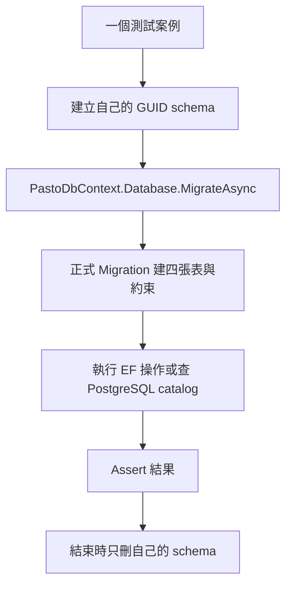

# S1-02 完成報告與維護導讀

日期：2026-11-08。對象：接手 Pasto 的維護工程師，包含剛接觸 EF Core／PostgreSQL 的開發者。

## 1. 本階段完成了什麼

S1-02 建立了後端的正式資料儲存基礎：定義 C# 資料模型、它們如何對應 PostgreSQL，以及如何建立正確的資料表、外鍵與索引。整合測試也改為使用這份正式定義。

這個階段還不能讓使用者在網頁上建房或分享文字。它提供的是後續功能可以依賴的資料庫基礎，並先驗證最容易出錯的房主關聯與資料庫結構。

版本紀錄：

| 項目 | 版本／結果 |
| --- | --- |
| S1-02 實作 commit | `6846558`，`feat: establish production persistence and migrations` |
| Pull Request | [PR #1](https://github.com/ARueiz/Pasto/pull/1)，另包含文件基準與 S1-01 |
| 合併 commit | `00a9890a6e9c35e77823637649b180ff8adc0a40` |
| GitHub 合併時間 | 2026-11-08 22:45:53（台灣時間） |
| 本機同步確認 | `main` 已 fast-forward 至合併 commit，合併後檔案內容與 `6846558` 相同 |

本報告說明以上版本；之後若程式演進，請同時核對 Git 歷史與最新階段計畫。

## 2. 為什麼要做這次修改

S1-01 只有測試專案。測試使用自己的 `schema.sql` 建表，再用 `RoomTestDbContext` 操作資料。這足以驗證資料庫設計是否可行，但產品出現後，如果另外建立一套模型，測試與產品可能逐漸不同。

S1-02 將模型與建表方式移到正式的 `src/Pasto.Server`。測試直接引用它，使用正式 Migration 建立資料庫結構。舊的測試 DDL 與 DbContext 已移除。

| 修改前 | 修改後 |
| --- | --- |
| 測試自己保存資料模型與建表 SQL | 正式專案保存模型與 Migration |
| 測試證明測試專用 schema 可用 | 測試證明正式 Migration 建出的 schema 可用 |
| 沒有正式後端 host 與 Solution | 有最小 host、分層資料夾與統一建置入口 |

既有 Creator 測試的資料準備 helper 暫時保留，只改用正式模型；它還不是產品的 CreateRoom 流程。這部分將在 S1-03 接續實作。

## 3. 先看懂整體架構

目前採用一個 ASP.NET Core 專案，以資料夾區分責任，沒有拆成多個服務或加入額外框架。

```text
Pasto.slnx                         一起建置後端與整合測試
src/Pasto.Server/
  Program.cs                       啟動 host，讀設定，註冊 DbContext
  Api/                             預留給 REST／SignalR 的傳輸處理
  Application/                     預留給建房等操作流程與交易協調
  Domain/RoomEntities.cs           四種資料模型，不引用 EF 或 HTTP
  Infrastructure/Persistence/
    PastoDbContext.cs              C# 模型與資料表的對應
    PastoDbContextFactory.cs       提供 EF 指令使用的 DbContext
    Migrations/                    資料庫結構變更與模型快照
tests/Pasto.IntegrationTests/
  PostgresTestDatabase.cs           每個測試的資料庫環境與清理
  CreatorIntegrityTests.cs          房主關聯的成功與失敗案例
  MigrationSchemaTests.cs           正式 schema 與 Migration 的驗證
```

| 層 | 負責什麼 | S1-02 狀態 |
| --- | --- | --- |
| Api | 接收 HTTP／Hub 請求、處理傳輸格式，呼叫 Application | 目前只有職責說明，尚無 endpoint |
| Application | 決定一次操作要做哪些事，協調交易與流程 | 尚無正式 use case，未建立空介面或通用 Repository |
| Domain | 保存資料模型，後續承載適合放在此層的商業規則 | 目前是四個可持久化的資料類別，不代表授權或容量規則已完成 |
| Infrastructure | 使用 EF Core／PostgreSQL 實際存取與建立資料庫結構 | 本次實作重點 |

`Program.cs` 是組裝入口，可以引用 Infrastructure 註冊相依。未來 Api 應經由 Application 操作，不直接把 DbContext 查詢散落在 endpoint。

## 4. 建議的程式閱讀順序

### 第一步：資料到底長什麼樣子

讀 [RoomEntities.cs](../src/Pasto.Server/Domain/RoomEntities.cs)。四種模型分別對應：

| 模型／資料表 | 內容 | 最重要的關係 |
| --- | --- | --- |
| Room／rooms | 房碼、房主 ID、建立／到期／關閉時間、版本與統計 | 房主必須是同房 Participant |
| RoomParticipant／room_participants | 房間內匿名身分、憑證雜湊 | 一個 Participant 屬於一個 Room |
| ClipboardItem／clipboard_items | 文字、UTF-8 bytes、擁有者與建立版本 | 擁有者必須是同房 Participant |
| RoomCodeReservation／room_code_reservations | 房碼與可回收時間 | 房間刪除後仍保留，避免房碼立即被重用 |

`Room.Id` 是內部 UUID；`Room.Code` 是分享／輸入用的六碼。兩者不能混用。`CredentialHash` 只保存 SHA-256 雜湊，資料模型不保存明文憑證。`TotalBytes` 僅作統計，不能拿來恢復舊的每房 1.5 MiB 硬限制。

目前這些類別仍有公開 setter；建立合法資料與保護操作權限，不能只靠類別本身，還需要後續 use case 與資料庫約束配合。

### 第二步：C# 如何對上資料表

讀 [PastoDbContext.cs](../src/Pasto.Server/Infrastructure/Persistence/PastoDbContext.cs)。

`DbSet<Room>` 可以視為 EF 查詢／追蹤 Room 的入口。`OnModelCreating` 告訴 EF：C# 的 `CreatorParticipantId` 對應哪個欄位、哪些欄位唯一、哪些關係是外鍵，以及需要什麼索引與 CHECK。

例如 `HasColumnName("room_id")` 是欄位命名對應；`HasForeignKey(...)` 是關係設定；`HasIndex(...)` 是索引設定。這份 mapping 同時也是未來產生 Migration 時的模型來源。

### 第三步：資料表實際怎麼建立

讀 [InitialPersistence Migration](../src/Pasto.Server/Infrastructure/Persistence/Migrations/20261108135901_InitialPersistence.cs)。

| 檔案／方法 | 用途 | 維護時的做法 |
| --- | --- | --- |
| Migration 的 `Up` | 套用這一版資料庫結構 | 審查建表、外鍵、索引及手寫 SQL |
| Migration 的 `Down` | 回退這一版變更，本次會刪產品表 | 有資料損失，不在一般啟動或停止時使用 |
| `.Designer.cs` | 記錄這一版 Migration 對應的模型 | 通常由工具產生，不當作手改入口 |
| `PastoDbContextModelSnapshot.cs` | 記錄最新模型，供下一次產生 Migration 比較 | 不是資料備份，也不代表實際 DB 已套用 |

EF 能表達的 CHECK 與部分索引同時記錄在 mapping／snapshot；本次 Migration 依既定設計用明確 SQL 建立它們。這讓後續工具比較模型時，知道它們原本就存在。

**最重要的例外是 `DEFERRABLE`：EF 模型沒有記錄它，所以必須由 Migration 手動保留。**

### 第四步：測試如何使用正式程式

讀 [PostgresTestDatabase.cs](../tests/Pasto.IntegrationTests/PostgresTestDatabase.cs)，再讀兩個測試類別。



schema 是同一個 PostgreSQL database 內的命名空間。每例建立 `pasto_it_<GUID>`，透過 `search_path` 將沒有指定 schema 的表名導向自己；`__EFMigrationsHistory` 也在其中，記錄該 schema 已套用的 Migration。

因此測試不需要預先手動跑 `database update`。測試只接受 loopback 與 `_test` 結尾的 DB，正常結束會清理自己的 schema，Migration 初始化失敗也會嘗試清理。不會刪整個 database，也不掃刪別人的 schema。程序被強制終止時仍可能留下資料，需確認來源後人工處理。

## 5. 為什麼房主外鍵比較特別

Room 必須有房主；房主 Participant 又必須屬於 Room，兩邊互相參照。若每次寫入立刻檢查全部外鍵，先寫哪邊都可能因另一邊尚不存在而失敗。

目前驗證的做法，是先產生 Room／Participant UUID，在**同一個交易**中分階段寫入：

1. 寫入房碼保留紀錄，呼叫 `SaveChangesAsync`。
2. 寫入 Room，包含即將建立的房主 ID，再呼叫 `SaveChangesAsync`。
3. 寫入同房 Participant，再呼叫 `SaveChangesAsync`。
4. 提交交易（commit），讓資料庫檢查延後的外鍵。

`SaveChangesAsync` 是將當下的 EF 變更送到資料庫，不代表外層交易已 commit。這個區別讓三次寫入仍可以一起成功或一起回滾。

`DEFERRABLE INITIALLY DEFERRED` 表示這條外鍵預設延到交易提交時才檢查；不是取消外鍵。Creator 若指向另一房的 Participant，commit 仍會被拒絕。每次只新增一個 entity，也避開 EF 同時追蹤整個循環 graph 時的寫入排序問題。

Owner／Creator 的複合 FK 同時檢查 RoomId 和 ParticipantId，避免「Participant 確實存在，但屬於別房」仍通過。Room 對 children 的 CASCADE 則設定為刪 Room 時一起刪 Participant／文字；保留碼不跟著刪除。

這些都是資料庫完整性保證。它們尚不能取代 API 層的「是否為本人」「房間是否到期」等授權檢查。CASCADE 的 catalog 定義已驗證，但實際帶資料刪房的行為測試留在 S1-03。

## 6. 已驗證什麼，還沒有驗證什麼

| 測試 | 證明的內容 |
| --- | --- |
| `SameRoomCreator_CommitsThroughStagedEfWrites` | 正式 schema 上，同房 Room／Creator 分階段寫入可在同交易提交，資料可讀回 |
| `CreatorFromAnotherRoom_IsRejectedAtCommitAndRollsBackNewRoom` | 跨房 Creator 被拒絕，新房相關三筆資料回滾，原房資料仍存在 |
| `Migration_PreservesCompositeForeignKeysAndCascadeDefinitions` | 實際 DB 的五條 FK 參照欄位、刪除動作與 deferred 定義符合預期 |
| `Migration_CreatesChecksAndRequiredIndexes` | 八條 CHECK 與完整 14 個索引名稱正確，必要索引內容符合預期 |
| `Migration_CanReapplyAndRollbackWithoutModelDrift` | 模型與 snapshot 無差異；Migration 重跑、回退與重建可行 |
| `MigrationHistory_IsIsolatedPerTestSchema` | 回退其中一個測試 schema，不影響另一個的表與 Migration 紀錄 |

驗證環境為 SDK 10.0.402、runtime 10.0.13、Docker PostgreSQL 18.6。鎖定套件還原、Release Build（0 warning／0 error）、格式檢查通過；審查修正後連續兩輪各 6 passed／0 failed／0 skipped，測試前後查詢均無殘留測試 schema。

首次加入完整索引集合斷言時漏列 history PK，曾有一輪 5 passed／1 failed；補齊後才得到上述兩輪通過結果。失敗與成功 TRX 留在本機已忽略的 TestResults，**不是 repo 可下載的 CI 產物**。Claude 做了兩輪靜態審查，第二輪核對 TRX，沒有獨立重跑測試。詳細證據見 [testing.md](testing.md)。

提交前另移除 DbContext 檔尾的多餘空白行，沒有修改程式邏輯，未因此重跑測試。本次撰寫報告時確認合併 tree 與 `6846558` 相同，沒有重新執行 Build／tests。

目前尚未交付：正式 CreateRoom、房碼碰撞重試、完整失敗注入、Owner／cascade 行為、同房併發、期限邊界、REST、前端、SignalR、安全與效能壓測。六例通過不能解讀成完整 MVP 已完成。

## 7. 如何在本機操作

在 repo 根目錄執行。已有 `.env` 或 DB 時直接沿用，勿覆蓋；密碼不進 Git。

```powershell
# 首次設定才複製，並自行填入測試密碼：
# Copy-Item .env.example .env
docker compose up -d --wait
dotnet tool restore
dotnet restore Pasto.slnx --locked-mode

$env:PASTO_TEST_CONNECTION_STRING = 'Host=127.0.0.1;Port=55432;Database=pasto_test;Username=pasto_test;Password=<本機測試密碼>'
dotnet build Pasto.slnx -c Release --no-restore
dotnet test Pasto.slnx -c Release --no-build --no-restore
dotnet format Pasto.slnx --no-restore --verify-no-changes
```

三個設定各有用途，不能以為填好 `.env` 就全部完成：

| 設定 | 誰讀取 | 用途 |
| --- | --- | --- |
| `.env` 的 `PASTO_POSTGRES_PASSWORD` | Docker Compose | 傳給 PostgreSQL 容器初始化密碼；不會更新已初始化 DB 的密碼 |
| `PASTO_TEST_CONNECTION_STRING` | 測試 fixture | 連接專用測試 DB，建立獨立 schema |
| `ConnectionStrings__Pasto` | Web host 與 EF design-time factory | 提供正式 DbContext 的連線設定；不是指必須連正式環境 DB |

如果只想看將要執行的 SQL，可以用本機專用連線產生檢閱檔：

```powershell
$env:ConnectionStrings__Pasto = $env:PASTO_TEST_CONNECTION_STRING
dotnet ef migrations has-pending-model-changes --project src/Pasto.Server
dotnet ef migrations script --project src/Pasto.Server --output src/Pasto.Server/obj/migration.sql
```

產生 script 不會套用 DB；輸出的 SQL 受 obj ignore 規則排除，正式來源仍是 Migration。`dotnet ef database update` 才會變更目標 DB，執行前需確認連線與 SQL；平常跑整合測試不用它。

`Program.cs` 不會自動套用 Migration；若要啟動 host，需先設定 `ConnectionStrings__Pasto`，再執行 `dotnet run --project src/Pasto.Server`。此階段沒有任何 endpoint，HTTP 404 是預期結果，啟動成功也不表示 DB 連線或產品功能已通過驗證。

## 8. 接手維護時最容易踩到的地方

1. **新增 Migration 後要看 SQL。** 尤其重建 `fk_rooms_creator`／`fk_items_owner` 時，EF 可能重新產生立即檢查的 FK。必須手動保留 deferred 並通過 catalog 與 Creator 測試。
2. **不要只改 mapping 就當 DB 已更新。** mapping、snapshot、Migration 與實際 DB 的套用紀錄各有角色；`HasPendingModelChanges` 只檢查模型／snapshot，不單獨證明 DB 完整正確。
3. **不要重新建立第二套測試 schema。** 新功能的測試沿用正式 DbContext／Migration；未來正式 CreateRoom 出現後，也要讓適合的測試呼叫它。
4. **不要把統計當成已實作的容量管制。** CHECK 可限制欄位範圍，但 ItemCount／TotalBytes 是否等於實際文字統計，仍須後續鎖內交易維護與行為測試。
5. **索引增減與套件升級會影響測試。** 現在固定四張表的 13 個索引及 history PK。額外 Creator FK 索引是刻意保留的 EF 慣例；provider 升級若改名稱，先審查差異再更新斷言。
6. **清理指令可能刪資料。** `docker compose down` 保留 volume；`down --volumes` 會刪測試 DB。測試中的 `DROP SCHEMA ... CASCADE` 只針對當例內部產生的名稱，不複製成掃刪腳本。

下一步依 [Sprint 1 計畫](sprint-1-implementation-plan.md) 進行 S1-03：實作正式 CreateRoom 交易、有界房碼碰撞重試，並驗證 Owner／cascade 與失敗回滾。設計規則仍以 [需求](requirements.md)、[架構](architecture.md) 與 [ADR 0003](decisions/0003-mvp-scope-reduction.md) 為準。
