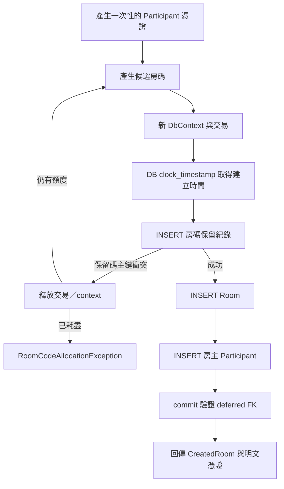

# S1-03 — 正式建房交易與資料完整性

本階段以 S1-02 的正式 schema 為基礎，把建房方式從測試 fixture 移入正式程式。沒有改表、加套件或新增 HTTP endpoint。

## 程式閱讀順序

1. [CreateRoom](../src/Pasto.Server/Application/Rooms/CreateRoom.cs)：一次操作產生憑證；每次嘗試產生房碼；碰撞時有限重試，成功後才回傳結果。
2. [介面與結果型別](../src/Pasto.Server/Application/Rooms/RoomCreationContracts.cs)：Application 用窄介面呼叫儲存與隨機產生器，不引用 EF／Npgsql。
3. [RoomCreationStore](../src/Pasto.Server/Infrastructure/Persistence/RoomCreationStore.cs)：建立新的 DbContext／transaction，以三次 SaveChanges 寫保留碼、Room、房主，最後 commit。
4. [RoomSecrets](../src/Pasto.Server/Infrastructure/Security/RoomSecrets.cs)：產生六碼、128-bit 憑證與 SHA-256 hash。
5. [Program.cs](../src/Pasto.Server/Program.cs)：註冊 factory、服務與可調整的重試上限。

Application 決定操作與重試；Store 負責一次原子寫入。這不是通用 Repository，也不是第二套持久層。每次房碼碰撞後，該次 context／交易都已釋放，再開始下一次，避免沿用 PostgreSQL aborted transaction 或不乾淨的 EF tracking。

## 一次建房如何執行



建立時間取 DB 當下時間，期限固定為建立後 5 小時，保留碼可回收時間為期限再加 24 小時。Room／Participant ID 由 Server 產生；建立時 Version、ItemCount、TotalBytes 都是 0。

三次 SaveChanges 共用同一個 DbTransaction，房主外鍵仍到 commit 才檢查。成功結果只在 commit 後回傳。寫入中途或 commit 前失敗時，交易隨資源釋放回滾，不留下半套房間。

只有 `PK_room_code_reservations` 的 23505 會被辨識成碰撞。程式不先 SELECT 空碼，也不回傳既有房間；只剩保留碼、Room 已被清除的冷卻碼同樣會拒絕。

其他錯誤，包括 Credential UNIQUE、Creator FK、DB 暫時錯誤與取消，都不進入房碼重試。若 DB 已 commit 但呼叫端未取得成功結果，資料可能已存在，不能自動重送或假稱已回滾。S2 再設計 HTTP 的錯誤對應與結果不確定提示。

## 憑證與日誌

- 六碼：以 `RandomNumberGenerator.GetString` 從 A–Z／0–9 均勻取樣。
- 憑證：16 個隨機 bytes，轉成無 padding 的 Base64URL，長度 22 個字元。
- Hash：對「實際傳給 Client 的憑證字串」之 UTF-8 bytes 取 SHA-256。後續驗證器必須使用相同規則。
- Store 只拿到 hash，不接收明文憑證。Application 在成功結果中交付明文，型別不用自動列印欄位的 record。
- 碰撞日誌只記錄嘗試次數與上限，不記錄房碼、憑證或 hash。不代表已完成 HTTP／代理等整條鏈路的脫敏檢查。

六碼不是安全憑證；知道或猜中碼就可能加入。真正公開 API 仍要在 S2 起補上授權、基本限流與日誌等防護。

## 可調整設定

`CreateRoomOptions.MaxCodeAttempts` 預設 5 次，允許 1～20；過大的值會增加資源耗用，因此在 host 啟動與 CreateRoom 建構時都檢查。

```powershell
# ASP.NET Core configuration 的巢狀鍵在環境變數用雙底線。
$env:RoomCreation__MaxCodeAttempts = '5'
```

沒有在 `.env` 加這個值，因為 Compose 的 `.env` 不會自動匯入 Web host。目前仍沒有 endpoint，啟動 host 不會自動建房，也不會自動執行 Migration。

## 測試與完成界線

既有 Creator 正例改為呼叫正式 Application／Store；跨房／缺房主反例用 EF interceptor 污染或省略實際寫入，保留 DB 約束。產品程式沒有故障測試開關。

`RoomCreationTests` 驗證已用碼／冷卻碼、有限重試、非房碼 unique 錯誤、寫 Room 後／寫 Participant 後／commit 前失敗、取消與 commit 後例外。兩個獨立交易同碼競爭以 barrier 明確安排時序，不用任意 sleep。

`OwnershipAndCascadeTests` 驗證同房 Owner 成功、跨房 Owner 拒絕、實際刪 Room 清掉 children、保留碼與他房資料不變，以及單刪 Creator／被引用保留碼遭拒。這些直接操作資料庫是完整性驗證，不是新增產品刪房或 Participant 刪除功能。

共 24 個測試通過（23 個真 DB、1 個生成格式／hash 測試）；錯誤與 TRX 紀錄見 [testing.md](testing.md)。Claude 已完成靜態審查，沒有 P0～P2 問題，但沒有獨立重跑測試。本階段尚未完成同房文字並行、鎖內統計、期限邊界、REST／UI／SignalR，尚未 commit。

## 審查後的決策與待辦（2026-11-09）

- **Commit 取消**：保留呼叫端 CancellationToken。取消／斷線發生在 commit 期間時，結果可能不確定；不能把 OperationCanceledException 直接等同於 rollback。改用 CancellationToken.None 仍無法保證明文憑證回到 Client，因此本階段不以此改變取消策略。
- **新增證據**：在 TransactionCommitted interceptor 的明確時間點取消 token 並拋出取消例外，驗證沒有重試、三筆資料仍保留。這是例外語意測試，不是 Npgsql COMMIT 與網路 cancel request 的實際競爭測試。
- **S2 必做**：HTTP 錯誤處理區分提交前取消與可能已提交的操作，不對結果不確定的 POST 自動重送；明文憑證回應遺失仍不能恢復。Client 已斷線時也不保證能收到錯誤提示。
- **Savepoint**：沒有量測額外往返或延遲，本次保留 EF 預設 AutoSavepointsEnabled。S8 若量測顯示值得調整，再確認可安全關閉，不先作效能優化。
- **S2 的 host 測試**：直接測真正 Program.cs 的 DI 組裝、生命週期、預設／非法 MaxCodeAttempts 與 ValidateOnStart，不複製一份註冊程式來測自己。目前手動組裝 Application 的測試不涵蓋 host。

提交結果不確定的背景可參考 [EF Core 官方說明](https://learn.microsoft.com/en-us/ef/core/miscellaneous/connection-resiliency#transaction-commit-failure-and-the-idempotency-issue)。

後續每個 S1 小階段開始前先建立自己的功能分支；S1-04 將接續新增／刪除／關房交易與鎖內一致性測試。
